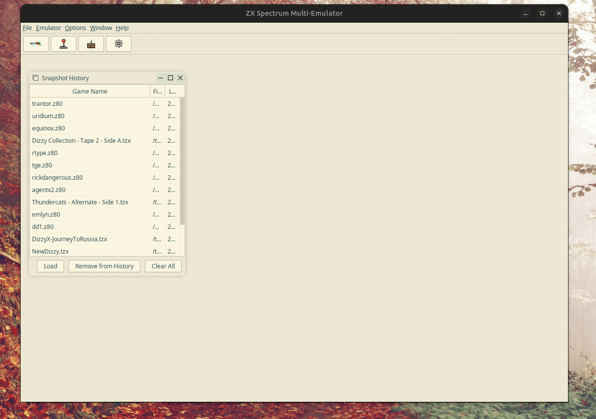

# OOZX

**A ZX Spectrum emulation environment, object-oriented all the way down to the Z80.**

[](https://github.com/fpetrola/oozx/actions/workflows/maven.yml)



A desktop where you run as many Spectrums as you like, plug real hardware into them by hand, pull games
straight from the catalogue, and run them at hundreds of times real time. Underneath, a machine model made
entirely of objects, which is what makes all of that cheap to build and possible to extend.

## What you can do here

- **Run several Spectrums at once.** Each window is its own machine, with its own model, speed, sound and
  pokes. Quit, reopen, and they come back running where they were.
- **Plug hardware in by hand.** More than two dozen peripherals, each a window. Clip it onto a machine to connect it,
  unclip to disconnect. Drive bays with motor lights, disks you insert, flip and write-protect, the Multiface's
  red button, the ZX Printer's paper, the Interface 1's RS-232 terminal.
- **Play from the catalogue, no files.** Search ZXInfo.dk, filter by machine and genre, and load a title into a
  new machine. It picks the right file out of the archive and the right model from the tape.
- **Watch a recorded playthrough, then take over.** Recordings from ZXInfo and the RZX Archive, several playing
  side by side, and a button that hands you the machine mid-replay.
- **Run at 300 times real time**, with sound and screen on, on a laptop. A speed dial from 25 % to 40,000 %,
  paced by the sound card so it never stutters.
- **Load from a real cassette player** through the sound card, with a live oscilloscope. Or use the tape deck
  per machine: audible loading, auto-load at 20,000 %.
- **See the picture as it came through the lead:** RGB, Scart, composite or aerial, with phosphor,
  persistence and scan lines, up to xBRZ scaling, saved as named profiles.
- **3,683 pokes** built in and matched to the game you loaded.

## And everything you expect

| | |
|---|---|
| Machines | 16K, 48K PAL and NTSC, 128K, +2, +2A, +3, +3e, Pentagon 128/512/1024, Timex TC2048/TC2068/TS2068, Spectrum SE, Scorpion ZS 256, and seven clones |
| Tapes and disks | TAP, TZX, CSW, PZX; DSK, TRD, SCL, MGT, IMG, OPD, D40/D80; HDF and SD images; Microdrive and ROM cartridges |
| Snapshots and recordings | Z80, SNA, SZX, SP read and written; RZX read, written and replayed |
| Sound | beeper, AY-3-8912 with band-limited synthesis, Melodik, Fuller Box, Covox, SpecDrum |
| Video | contention per T-state, attribute and border changes drawn where the beam was, Timex hi-res and hi-colour, ULAplus |
| Input | Cursor, Kempston, Sinclair, Timex and Fuller joysticks, physical gamepads, Kempston Mouse, Recreated ZX |
| Storage and tools | Beta 128, +D, DISCiPLE, Opus, Didaktik, DivIDE, DivMMC, ZXATASP, ZXCF, ZXMMC, Interface 1 and 2, Multiface One/128/3, ZX Printer, parallel port |

## Why it can do that

- **The Z80 is made of objects.** Every instruction, operand and register is an object you can execute,
  inspect, clone or replace on its own. That is why the code of a game can be analysed and not only run, and
  the same hooks give tracing and profiling for free.
- **Nothing foreign inside it.** Memory timing belongs to the Spectrum and MEMPTR is optional, so both are
  aspects attached from outside. Either can be left off; the processor never knows.
- **Every part behind a contract, no global state.** Processor, memory, I/O, sound and display are each
  swappable, and each has been swapped: RZX playback is the I/O replaced by the recording; the test harness is
  an instrumented memory; a machine is an object graph, so many of them share one process.
- **Hardware from outside.** A device answers ports on a bus that merges answers like the real one, watches the
  program counter to page its ROM in, and is found on the classpath. The core never names a device. The smallest
  peripheral is a hundred lines and comes with a complete window; most of the first twenty-two landed within two days.
- **Machines as configurations.** A model is a choice of pager, ULA and timing. The Pentagon was added mostly
  to see what adding a machine costs.
- **Incremental by construction.** One concept, one owner, one module, and the compiler enforces who may know
  whom. Features arrive as new modules; the code base shrinks as it improves.
- **Correctness travels with the model.** Fuse's 1,355 test vectors, an ALU reference of 131,072 combinations
  per instruction that caught bugs Fuse misses, emuStudio's suite. The same batteries run unchanged against any
  implementation of the processor, the machine was compared step by step with Fuse's real core, and recorded
  games replay deterministically.

## Speed by design

The object model is a fixed graph that a program can read, so a second core is **generated from it**: a partial
evaluator flattens the instructions, their operands and the timing aspects into one class with no objects on
the hot path. The build writes it, the jar carries it compiled, it is regenerated when the model changes, and it
passes the same tests as the model it came from. With the processor out of the way, each remaining layer was tuned in its own
class, measured before and after, none of them touching the model.

| | frames per second | times real time |
|---|---|---|
| Manic Miner, 48K, sound and screen on | 15,256 | about 305 |
| Jet Set Willy, 128K, sound and screen on | 12,867 | about 257 |
| Generated core against the object-oriented core | 4.3× | |

Speed reached by design rather than against it, and switchable at runtime: the object-oriented core stays the
reference. These are this emulator's own figures; no other emulator has been measured beside it yet. The
measurement diary is in `doc/`.

## What it opens next

- A new machine or peripheral costs what a module costs.
- A tool of its own is built on this model: a translator that turns a game into a Java program. Twenty-nine
  games are in its catalogue today, and Head over Heels follows a recording of the game being played for
  174,364 frames. It grows by the game, apart from the environment, which runs the same without it.
- A debugger or a disassembler is one more visitor over the same instructions.
- Rewind is cloning the state. A different generation target is a different back end for the same generator.

## Run it

A Java 21 runtime, or newer, and one file: `oozx-<version>.jar` from the
[latest release](https://github.com/fpetrola/oozx/releases/latest). It carries every plugin and the fast core,
already compiled.

```bash
java -jar oozx-<version>.jar
```

## Build it from source

JDK 21 or newer and Maven.

```bash
git clone https://github.com/fpetrola/oozx.git
cd oozx
mvn -DskipTests install
java -jar machine/app/target/app-<version>-all.jar
```

The released jar is this build with [oozx-plugins](https://github.com/fpetrola/oozx-plugins) built beside it
and packed inside; `.github/workflows/release.yml` is the recipe, step by step.

Where things live: `emulator` is the Z80; `machine/core` the Spectrum, with no Swing in it;
`machine/generated` the fast core; `machine/app` the desktop; `machine/bridge` the comparison with Fuse. What
plugs into all this - the boards, the machines that are not the 48K, the windows, the readers for the other
file formats, and the recordings (`libs/zx-rzx` and `libs/rzx`) - is
[oozx-plugins](https://github.com/fpetrola/oozx-plugins), built against this and published a jar at a time. The
translation of a game to Java has moved to a repository of its own.

## Credits and license

The [Fuse](https://fuse-emulator.sourceforge.net/) authors, for the test vectors, the timing model and the core
the bridge runs; Cristian Dinu, for the [decoding of the Z80 opcode byte](http://www.z80.info/decoding.htm);
Peter Jakubčo's [emuStudio](https://www.emustudio.net/), for its Z80 test suite; [ZXInfo.dk](https://zxinfo.dk/),
[ZXDB](https://github.com/zxdb/ZXDB) and the [RZX Archive](https://www.rzxarchive.co.uk/), for the catalogues. The part of
ZXDB that ships with the emulator is a derived database, open under the same terms as ZXDB itself (ODbL 1.0).

Licensed under the GNU General Public License, version 3 or later. See `LICENSE`.
