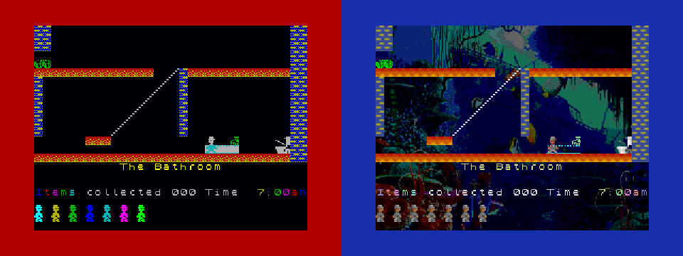
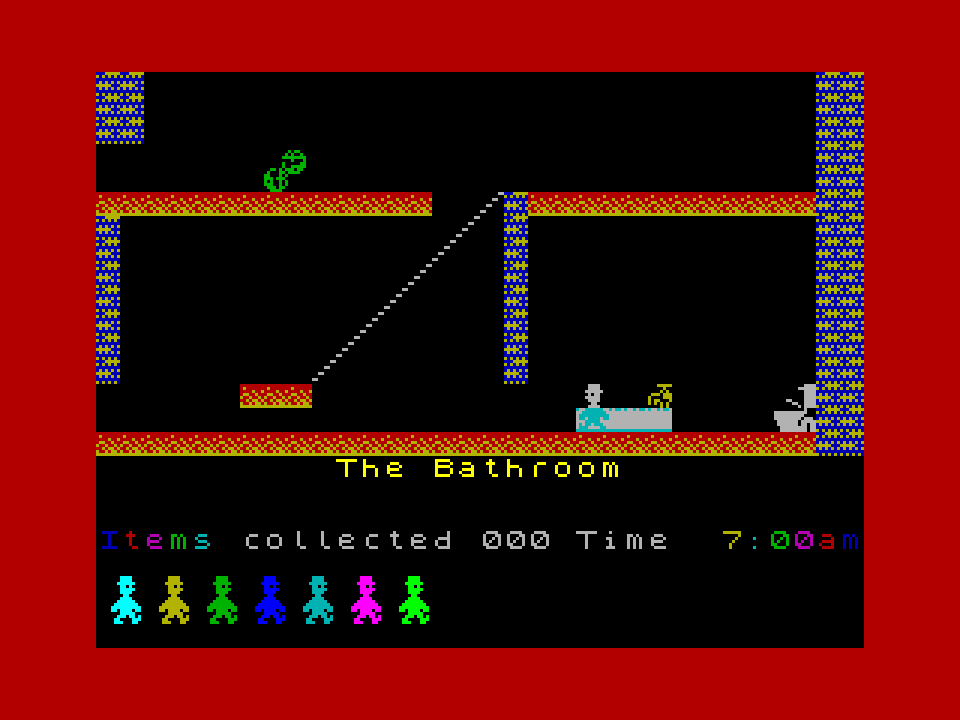
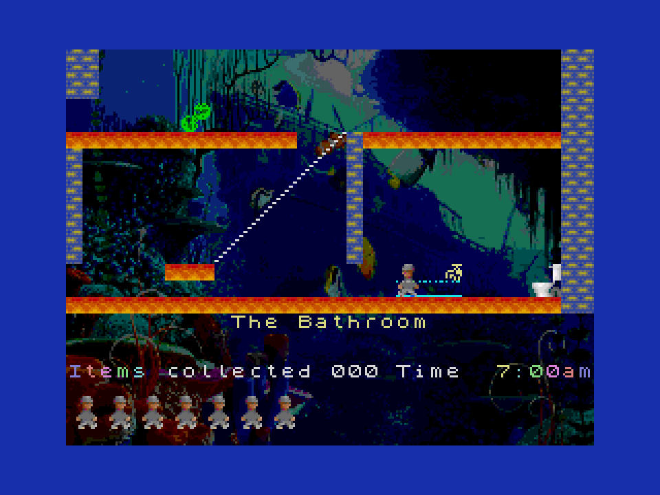
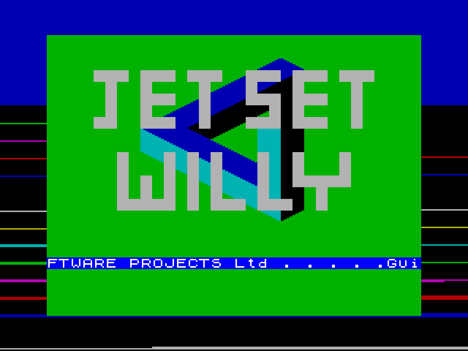
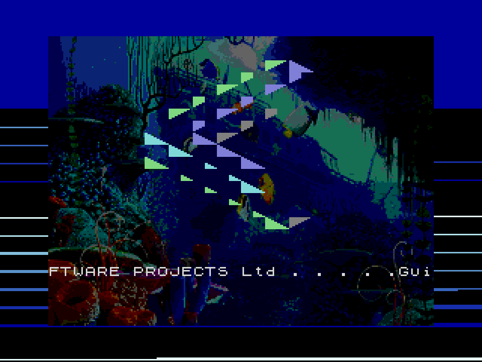

# 256 colours

A 1984 game in 256 colours, with the game's own code untouched. Put a Spec256 colour file beside a game and
the machine plays it in colour, with no colour clash, over photographic backgrounds.

This is beta: of the thirteen games in the table below, eleven come out 90 % identical to their reference
picture or better, and two do not.



*Jet Set Willy, the same room and the same ten seconds, twice: the machine as Sinclair sold it, and the same
machine with a `jsw.gfx` file lying beside the snapshot.*

| Jet Set Willy, as Sinclair shipped it | The same room, the same moment, in 256 colours |
|---|---|
|  |  |

Spec256 was a DOS emulator from 1999 with one very good idea: leave the game alone, and give its *graphics*
eight bits per pixel. The coloured graphics travel through the game's own code, so the game plays exactly as
it always did and comes out in 256 colours. OOZX runs that format, and it is not the only emulator that
does.

## Using it

Put the game's colour file next to the game:

```
mygame.sna        the game, a 48K snapshot
mygame.gfx        393,216 bytes: eight colour bytes for every address of RAM
mygame.cfg        optional: EmuZWin's mixing rules for this game
mygame.B00 ...    optional: 320×200 backgrounds, one byte per pixel
rom0.gfx          optional: the same for the ROM
```

Open the snapshot as you open anything. The machine sees the colours beside it, moves itself onto the nine
processors that run them, and opens a window showing the game in 256 colours. Load anything else and it goes
back to where it was. In the game browser, *256 colors* shows the games of yours that have colours beside
them.

And the title screen, where a background file replaces what the game left black:

| | |
|---|---|
|  |  |

The stripes down the sides are the game's own border effect, drawn where the beam was when it happened.

## How right it is

Measured on 14 September 2026 against the 29 games of the public Spec256 collection that ship a `.SNA` and a
`.GFX`: 300 frames each with everything at its default, compared pixel by pixel against the title-screen
capture each game carries, over all 49,152 pixels. Thirteen of them are in this table; the working notes have
the rest.

| Game | Identical | |
|---|---|---|
| Atic Atac, Phantis | 100.00 % | |
| Dizzy 1 | 99.31 % | |
| Scooby Doo | 99.08 % | |
| Jetpac | 99.02 % | was 94.50 % until its `ROM0.GFX` was loaded |
| Cybernoid | 98.91 % | the rest is within 16 per channel: this machine's dim white against the capture's |
| Solomon's Key | 98.63 % | 100 % within 16 |
| Knight Lore | 97.92 % | with background 0, the right one |
| Army Moves, Sabre Wulf | 95.9 %, 95.6 % | |
| Abu Simbel Profanation | 90.02 % | |
| Cybernoid 2 | 83.97 % | the frame's rope is animated: what differs is pixels on against off, not tones |
| Underwurlde | 36.17 % | the capture shows a green wall that is not in this copy of the game at all |

None of the twenty-nine hangs or comes up black.

## How it works: nine Z80s

The `.GFX` is eight bytes of colour for each of the 49,152 addresses of RAM, one byte per pixel. Those eight
bytes are sliced into eight planes: plane *v* holds, at each address, a byte whose bit *w* is bit *v* of the
colour of pixel *w*. A plane is therefore a 64 K memory shaped exactly like a Spectrum's, and that is the
whole idea.

So: run the game's code on the machine, and run **the same code, at the same time, on each of the eight
planes**. Whatever the game does to its graphics, shift them, mask them, blit them, animate them, happens to
the colours too, because the colours are in the same shape as the bytes.

That is nine processors in lockstep: the machine's own, and eight followers that go where it goes. A follower
has no ports, because what a port answers is never a colour. The picture is painted from the planes.

## What it costs to run

| | ms per frame | times real time |
|---|---|---|
| Generated core, picture off | 0.10 | ~200 |
| Object core, picture off | 0.35–0.38 | ~55 |
| Nine in lockstep, picture off | 4.31 | 4.6 |
| **Nine in lockstep, a real game painting itself** (Cybernoid, 256 colours) | **5.24** | **~3.8** |

These four rows were taken together, with the harness of the Spec256 notes, to be compared with each other.
They are not the figures on [How fast, and how we know](How-fast-and-how-we-know), which were taken another
way.

Nine processors cost about nine processors, which is the honest price of the idea. It is still faster than
a Spectrum, and it is only paid while a Spec256 game is loaded.

## What it cost the rest of the code: 258 lines

That is the part worth reading if you care about the design. The module is eleven classes and 1,689 lines.
When it landed, twenty-three files outside it changed, none of them by more than 33 lines, and **not one of
them has a special case for Spec256 in it**. Six seams, each of which is a thing the model was missing
anyway:

| Seam | For what |
|---|---|
| `Core.wrapping(Memory)` | a core may wrap the memory its processor runs over: how a follower sees what the machine writes |
| `FilesOfItsOwn` + `Snapshots` | "where did this snapshot come from", said once to whoever wants to hear it, so the peripheral can look beside it without anyone else knowing what a `.gfx` is |
| the instruction factory | a processor can be built with instructions that are not the ordinary ones, which is what lets eight planes execute in step without a second Z80 |
| `Picture.paintPair` | two pixels in colours that are in no palette, for whoever worked them out himself |
| `ContendedMemory.peek`/`poke` | reading and writing without counting T-states, for whoever looks at memory from outside the clock |
| `OOZ80(OOZ80)` | a copy constructor, to wrap a processor without rebuilding it |

One line was *removed*: a static array in `Ram`, when one rule ate the other three. What this says about the
rest of the design is on [Why it all fits](Why-it-all-fits).

## Where the knowledge came from

The original Spec256 is closed and DOS; EmuZWin, which inherited the format, is closed and Windows. Two open
implementations exist: GZX's, which says of itself "not 100 % done", and ZX-Poly's, which is the complete
one. Both were read as a specification and checked against a real game's files; no line was copied. The
palette is GZX's 768 numbers, declared in `NOTICE`, with entry 255 white rather than red, which is what the
rules treat as ink.

Where my reading differed from ZX-Poly's, it was measured rather than argued: the scoreboard of *Renegade*,
for one, turned out to be right here and wrong there, and the pack's own capture says so.

Every rule, every measurement and every hypothesis that died is in `doc/plan-spec256.md`.

That is the last page of this tour. If you have not yet, [get it and try it](Your-first-five-minutes). The
next tour is [the desk](The-desk).
