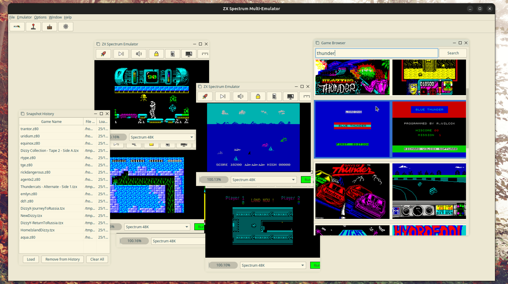

# Any game, a name away

Type a name and play. The catalogue is inside the emulator, and the double click does the eight things you
used to do by hand.

> **Clip** · *Type a name. Play.* The game browser, `dizzy`, a double click: a machine appears, `LOAD ""`
> types itself and the game arrives with its pokes. (`type-a-name`, filmed)

## Finding one

`Emulator → Game Browser...` searches [ZXInfo.dk](https://zxinfo.dk), which is the whole of
[ZXDB](https://github.com/zxdb/ZXDB), without opening a web browser or downloading anything by hand. Type in *Search* and press Enter. What
comes back is a wall of games, each with its own screen and how many recordings there are of it.

Down the left side:

| | |
|---|---|
| **Where** | ZXInfo's catalogue, the games on this computer, or both |
| **Order** | as found, the most known first (the most voted at World of Spectrum), or the best rated |
| **Machine**, **Genre**, **Year** | asked of the server, so they narrow the search itself |
| **RZX**, **Map** | only games with a recording to replay, or with a map |
| **Loadable** | hide what has nothing to download |
| **Only unknown** | the files of yours the catalogue could not name |
| **256 colors** | games with Spec256 colours beside them |

## Playing one

Double-click a game and it loads into a machine of its own. A right click has the rest:

| | |
|---|---|
| **Load Game** | as it comes, or on a machine you choose |
| **Load Version** | another of the files the catalogue has for it |
| **Play Recording** | somebody's recording of it → [Recordings and Take Over](Recordings-and-Take-Over) |
| **View Details** | its card, with everything there is about it → [Your files](Your-files) |
| **Add to Favorites** | keep it, in `Emulator → Favorites...` |

## What happened when you double-clicked

You typed a name and clicked twice. This is what the desk did, in order:

1. **Looked the game up** in ZXInfo or, when ZXInfo does not answer, in the copy of ZXDB inside the jar.
2. **Fetched the archive and opened it**, without asking you anything.
3. **Chose the file inside**, by score: a recording before a snapshot, a snapshot before a tape, a tape
   before a `.csw`; a bonus for "48" in the name, a penalty for a name that says "alternate".
4. **Chose the machine**: the one the catalogue says the game was made for. A snapshot goes onto the machine
   it was taken on.
5. **Got the ROM**, when the machine runs on one this build cannot ship: it asks, fetches it from whoever
   publishes it and checks its SHA-256.
6. **Typed `LOAD ""`**, the one you were about to type.
7. **Played the tape**: flat out when *Fast Loading* is on, at its own speed when it is not.
8. **Left everything ready**: the game's pokes, its card and its recordings.

Steps 5 to 7 happen only when they are needed: a ROM that does not ship, a game that is on tape.

Searching a catalogue from inside an emulator is not new. What happens after the game is found is the part
worth watching.

## Without the network

The 5,000 most voted games of ZXDB ship inside the jar, with their files, releases, maps and recordings
listed. When ZXInfo does not answer, that copy answers in the same shape, and nothing that asks can tell
which one did. Fetching a game still needs the network. What is contacted, and when, is on
[Network and privacy](Network-and-privacy).

## The ones you keep

`Emulator → Favorites...` holds the games and recordings you kept, remembering which entry inside a zip
each one was. The star on a machine's bar keeps the game it is running.

Next: [Your files: drop anything](Your-files).
