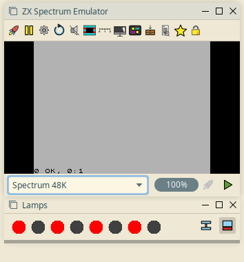

# Build a peripheral

Almost nothing in this emulator is in the emulator. Every peripheral, every machine but the 48K, every tool
and every other file format arrives in a jar and adds itself. Ten minutes from now, one of those jars can be
yours.

This page builds **Lamps**: eight lamps on port 255. Whatever a program writes there lights the lamps of the
bits that are set.



*What you will have at the end: the window you wrote, clipped under a 48K, after `OUT 255,170`.*

It is three classes and no registration. I built it as written here, against the build of 19 November 2026,
dropped it into a desk that had never seen it, typed the `OUT`, and it lit.

## What you need

JDK 21 or newer, Maven, and the emulator built once on your computer, because a plugin is compiled against
it:

```bash
git clone https://github.com/fpetrola/oozx.git
mvn -DskipTests install -f oozx/pom.xml
```

## 1. The project

One file, `pom.xml`. The last block is the part that matters: it is what makes the jar a plugin.

```xml
<project xmlns="http://maven.apache.org/POM/4.0.0">
  <modelVersion>4.0.0</modelVersion>
  <groupId>mine</groupId>
  <artifactId>device-lamps</artifactId>
  <version>1.0</version>
  <name>Lamps</name>

  <properties>
    <oozx>0.1.5</oozx>
    <crystal>0.1.5</crystal>
    <project.build.sourceEncoding>UTF-8</project.build.sourceEncoding>
  </properties>

  <repositories>
    <repository><id>jitpack</id><url>https://jitpack.io</url></repository>
  </repositories>
  <pluginRepositories>
    <pluginRepository><id>jitpack</id><url>https://jitpack.io</url></pluginRepository>
  </pluginRepositories>

  <dependencies>
    <dependency>
      <groupId>com.github.fpetrola.oozx</groupId>
      <artifactId>devices-kit</artifactId>
      <version>${oozx}</version>
      <scope>provided</scope>
      <exclusions>
        <exclusion><groupId>com.github.fpetrola.crystal-plugins</groupId><artifactId>framework-runtime</artifactId></exclusion>
        <exclusion><groupId>com.github.fpetrola.crystal-plugins</groupId><artifactId>framework-guice</artifactId></exclusion>
      </exclusions>
    </dependency>
    <dependency>
      <groupId>com.github.fpetrola.crystal-plugins</groupId>
      <artifactId>framework-api</artifactId>
      <version>${crystal}</version>
      <scope>provided</scope>
    </dependency>
  </dependencies>

  <build>
    <plugins>
      <plugin>
        <groupId>org.apache.maven.plugins</groupId>
        <artifactId>maven-compiler-plugin</artifactId>
        <version>3.3</version>
        <configuration><source>21</source><target>21</target></configuration>
      </plugin>
      <plugin>
        <groupId>com.github.fpetrola.crystal-plugins</groupId>
        <artifactId>framework-maven-plugin</artifactId>
        <version>${crystal}</version>
        <extensions>true</extensions>
      </plugin>
    </plugins>
  </build>
</project>
```

Three things about it:

- **The name follows the ones that ship**: `device-` for a peripheral, `tool-` for a tool.
- **`oozx` is the version you built.** It is in the `pom.xml` of the tree you cloned.
- **The two exclusions are not optional.** Without them the compiler finds a second processor on its path,
  which writes the same index twice, and the desk refuses the jar.

## 2. The peripheral

`src/main/java/mine/Lamps.java`. A peripheral is whatever answers ports. This one answers one port, takes
writes, and keeps the last byte:

```java
package mine;

import com.fpetrola.oozx.speccy.machine.SpectrumMachine;
import com.fpetrola.oozx.speccy.peripherals.PluggablePeripheral;
import com.fpetrola.oozx.speccy.ports.DefaultPortHandler;
import com.fpetrola.oozx.speccy.ports.Wired;
import com.google.inject.Inject;
import com.google.inject.Singleton;

import java.util.List;

/** Eight lamps on port 255: each bit of the last byte written there lights one. */
@Singleton
public class Lamps extends PluggablePeripheral {
  private volatile int lit;
  private volatile Runnable written = () -> { };

  @Inject
  public Lamps() {
    super(List.of());
    ports(Wired.at(0x00ff, 0x00ff, new DefaultPortHandler(false, true) {
      @Override
      public void write(int port, byte value) {
        lit = value & 0xff;
        written.run();
      }
    }));
  }

  /** Any machine: it hangs off the back and asks nothing of what it is plugged into. */
  @Override
  public boolean fitsOn(SpectrumMachine machine) {
    return true;
  }

  public int lit() {
    return lit;
  }

  public void whenWritten(Runnable told) {
    written = told;
  }
}
```

- **`Wired.at(mask, value, handler)`** is the wiring: the lines of the address bus this peripheral looks at,
  and what they have to say for it to answer. `0x00ff, 0x00ff` is "the low eight lines, all high": port 255.
  A real peripheral usually looked at fewer lines than that, and answered on many ports at once.
- **`DefaultPortHandler(false, true)`** takes writes and never answers a read.
- **`fitsOn`** says which machines it can be plugged into. Leave it out and it fits none: the default is for
  what a machine has built in.

## 3. What puts it in a machine

`src/main/java/mine/LampsDevices.java`. Every machine is put together from modules that are found rather
than named. This is yours:

```java
package mine;

import com.fpetrola.oozx.Extension;
import com.fpetrola.oozx.speccy.peripherals.Peripheral;
import com.google.inject.AbstractModule;
import com.google.inject.multibindings.Multibinder;

/** What puts the lamps inside every machine that is built, waiting to be plugged in. */
public class LampsDevices extends AbstractModule implements Extension {
  protected void configure() {
    Multibinder.newSetBinder(binder(), Peripheral.class).addBinding().to(Lamps.class);
  }
}
```

## 4. Its window

`src/main/java/mine/LampsEquipment.java`. The window is the front of the thing, and clipping it onto a
machine is what plugs the peripheral in. You write what it shows; plugging, unplugging and following the
machine about come with `DeviceFrame`:

```java
package mine;

import com.fpetrola.oozx.speccy.devices.DeviceFrame;
import com.fpetrola.oozx.speccy.devices.Equipment;
import com.fpetrola.oozx.speccy.devices.MachineFrame;
import dev.crystal.plugins.api.Offers;

import javax.swing.JComponent;
import javax.swing.JLabel;
import java.awt.Color;
import java.awt.Dimension;
import java.awt.Graphics;

/** The lamps' window: clipping it onto a machine is what plugs them in. */
@Offers("Plug in: Lamps")
public class LampsEquipment implements Equipment {
  public String name() {
    return "Lamps";
  }

  public MachineFrame open() {
    return new Front();
  }

  static class Front extends DeviceFrame<Lamps> {
    private final JComponent row = new JComponent() {
      @Override
      protected void paintComponent(Graphics pen) {
        int lit = device() == null ? 0 : device().lit();
        for (int lamp = 0; lamp < 8; lamp++) {
          pen.setColor((lit >> (7 - lamp) & 1) == 1 ? Color.RED : Color.DARK_GRAY);
          pen.fillOval(6 + lamp * 28, 4, 20, 20);
        }
      }
    };

    Front() {
      super("Lamps", Lamps.class);
      row.setPreferredSize(new Dimension(236, 28));
      controls.add(row);
      assemble(new JLabel(" OUT 255,n lights the lamps of the bits that are set in n"));
      setSize(330, 110);
    }

    /** Told when the window is clipped onto a machine, carried to another, or taken off. */
    @Override
    protected void plugged(Lamps lamps) {
      if (lamps != null) lamps.whenWritten(row::repaint);
      row.repaint();
    }

    @Override
    protected String expandTip() {
      return "Show the lamps, or just the bar";
    }

    @Override
    protected String attachTip() {
      return "Clip this onto a machine to plug the lamps in";
    }
  }
}
```

- **`name()`** is what `Emulator → Equipment` lists.
- **`@Offers`** is what `Discover → What do you want to do?...` finds when somebody types "lamps".
- **`controls`** is the bar of the window, the part that stays when it is folded. `assemble` takes what
  shows when it is unfolded.
- **`device()`** is the peripheral of the machine this window is clipped to, or nothing while it is clipped
  to none.

## 5. Build it, drop it in

```bash
mvn package
cp target/device-lamps-1.0.jar ~/.oozx/plugins/
```

The build wrote into your jar what it brings: which classes answer to which way in. You registered nothing,
and nothing in the emulator names your classes.

Start the desk. *Lamps* is under `Emulator → Equipment`, among the peripherals that came with it.

## 6. Light them

1. `Emulator → New Machine`, and `Emulator → Equipment → Lamps`.
2. Drag the Lamps window against the machine's.
3. On the Spectrum, type `OUT 255,170` and Enter. `OUT` is on the O key in extended mode: on your keyboard,
   Tab and then Ctrl+O.

Every other lamp is lit. Drag the window off and write again: nothing changes, because nothing is plugged
in.

## Where to go from here

- **Answer a read.** `DefaultPortHandler(true, false)` and `read(int port)`.
- **Bring a ROM**, a drive, a sound: the peripherals that ship are the worked examples, one small module
  each, in [oozx-plugins](https://github.com/fpetrola/oozx-plugins) under `devices/`. The ZXMMC is the
  smallest, the Kempston Mouse is the one closest to this.
- **Keep what it holds across a session.** A peripheral never saves itself; a mapping does it.
  → [A file format is a table](A-file-format-is-a-table)
- **Something that is not a peripheral**: a tool, a machine, a file format, a way of drawing the picture.
  Every way in there is, is on [Plugins](Plugins).

Last: [The rules of the code](The-rules-of-the-code).
