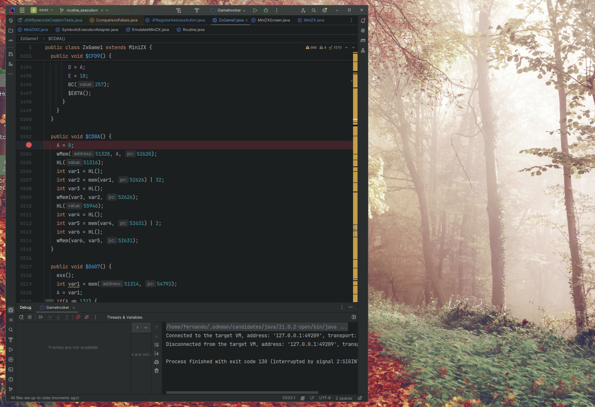
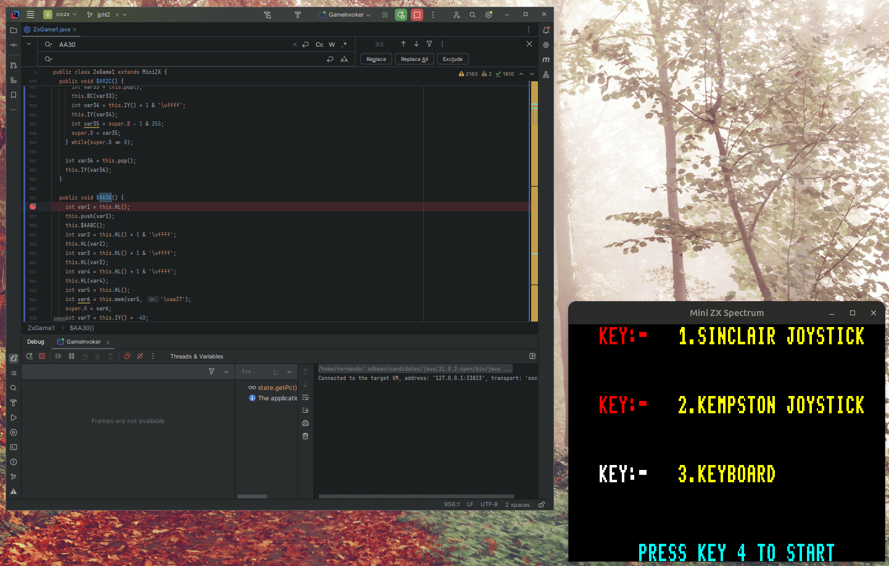
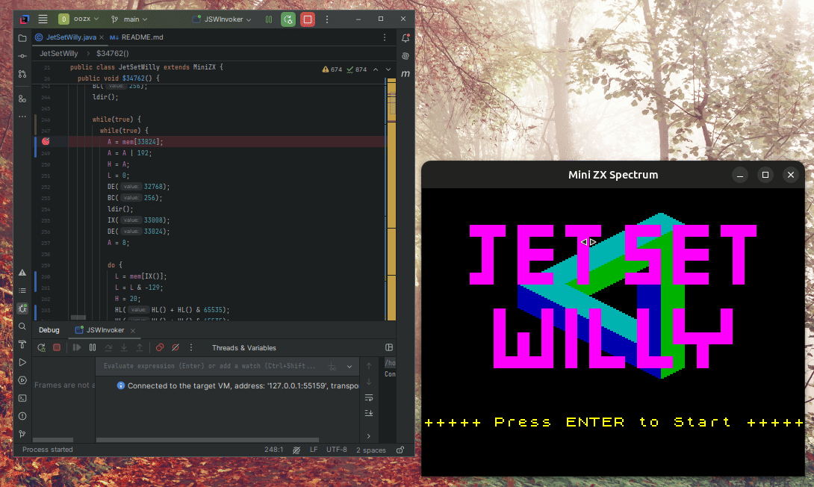

# Games as Java programs

This is not part of the emulator. It is a tool of its own, built on it: a translator that turns a Spectrum
game into a Java program. It translates some games today, and the list grows a game and an odd case at a
time; the environment runs the same with or without it.

What the environment gives it is the reason it exists at all: a Z80 made of objects.

An instruction here is an object with operands that are objects. You can execute it — or you can **run it
without a machine underneath**, symbolically, and record what it did: which addresses it reached, which
registers carried what, where it branched, what it wrote over. Do that from a game's entry point and you get
the shape of the program: its routines, its data, its self-modifying code.

Then emit Java.

## It runs

| | |
|---|---|
|  | Dynamite Dan, translated to Java, **stepped in a debugger**: breakpoints on `$CD8A()`, `wMem(51326, A, pc: 52626)` in the variables pane, and the game playing in a window with no emulator under it |





Twenty-nine games are in the translator's catalogue today, from Manic Miner and Jet Set Willy to Batman,
Head over Heels, The Great Escape, Fairlight, Skool Daze, R-Type and Rainbow Islands on the 128K. The class
that comes out has a method per routine, named after its address. This is the end of Jet Set Willy's, the
loop that drives the speaker:

```java
public class JetSetWilly extends MiniZX {
  public void $38601() {
    ...
    while(true) {
      pc(38631, 1, 4);
      int var6 = B();
      int var7 = A();
      alu("cp", var7, var6);
      pc(38632, 1, 7);
      if(flag(64, true)) {
        tstates(5);
      } else {
        pc(38634, 1, 7);
        D(24);
      }

      pc(38636, 2, 12);
      int var8 = BC();
      int var9 = D();
      out(var8, var9);
      ...
    }
  }
}
```

It reads like the Z80 it came from, one statement per instruction: the translation keeps the address, the length
and the cost of each, which is what lets it be checked. **A translation is held against a recording of the game
being played**: the Java program and the emulator replay the same recording side by side, and they have to
agree instruction by instruction. Head over Heels agrees with its recording for 174,364 frames. The earlier
captures above (Dynamite Dan in a debugger, Everyone's a Wally) are from the first translations.

It is Java. You can set a breakpoint in it, watch a variable, profile it, step through the frame in which
Willy dies.

## How it is done

1. **Symbolic execution** (`se`) runs the game with nobody playing: an `InstructionSpy` sits on
   the executor, the registers are backed by values that remember where they came from
   (`DirectAccessWordNumber`, `ReturnAddressWordNumber` — that is how a return address is recognised as one),
   and the memory records who wrote what.
2. **Blocks and routines** (`blocks`, `routines`) turn the trace into structure: what
   is code, what is data, where a routine starts and ends, which branches are real.
3. **Bytecode** (`bytecode`, `translator`) emits a class per game, a method per
   routine, with the Z80's registers as fields and memory as an array.
4. `MiniZX` is the runtime it extends: a screen, a keyboard, and the handful of operations the emitted code
   calls (`mem`, `wMem`, the 16-bit register pairs). The window in the animations above is exactly that.

A recording says where the game really went, so the translation starts from what a person's playthrough
reached, and the symbolic execution covers the branches that playthrough did not take.

## What it is good for

- **Reading a game.** The routines have names, the data has been told apart from the code, and the branches
  are visible. This is the decompilation of a 1984 binary into something a person can read.
- **Debugging a game with a modern debugger** — a real one, with breakpoints and watches, on the game's own
  logic.
- It is also a measure of the design underneath. The hooks a symbolic executor needs are the ones that give
  tracing, profiling and instrumentation for nothing, and the fixed object graph that makes the analysis
  possible is the one the [generated core](The-Generated-Core) is produced from. The translator did not
  have to change the emulator to get them.

## Where this lives

A repository of its own, `oozx-translator`, since November 2026: `se` (symbolic execution), `blocks`
(control-flow blocks), `routines`, `bytecode` and `translator` (the emission), `virtual` (the runtime); the
translated sources are under `translator/.../minizx/emulation`, and `translated-games.json` is the catalogue. It
is not published yet, and it does not plug into the desk yet either: it moves forward on its own, by the
number of games it can translate.
