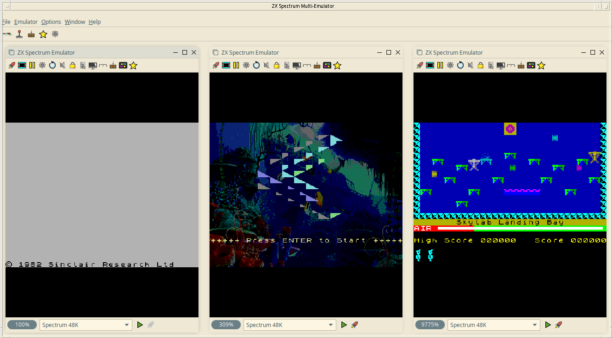

# Getting Started

## What you need

- **A Java 21 runtime, or newer.** A runtime is enough: the fast core comes already compiled.
- **One file**, `oozx-<version>.jar`, from the
  [latest release](https://github.com/fpetrola/oozx/releases/latest).
- Nothing else. The jar carries every plugin: the machines with the ROMs that can be shipped, the peripherals,
  the tools, 3,683 pokes, a catalogue of 4,922 games and one of 4,291 recordings.

```bash
java -jar oozx-<version>.jar
```

Plugins are added, removed and updated afterwards from `Emulator → Plugins...`.

## The first minutes



1. **A machine.** `Emulator → New Emulator` (Ctrl+N) opens one. The combo in its status bar says which model it is;
   change it there and the machine becomes that machine. The window is the machine — not a picture of one:
   close it and that Spectrum is gone.
2. **A game, without files.** `Emulator → Game Browser...` searches [ZXInfo.dk](https://zxinfo.dk).
   Right-click a title → *Load Game* and pick a model, or let the tape say which one it wants. See
   [Games: catalogue and library](Games-Catalogue-and-Library).
3. **A game you already have.** `File → Open` (Ctrl+O) takes tapes, snapshots, disks and recordings; the
   file decides where it goes — a recording opens the RZX player, everything else opens a machine.
4. **Speed.** The rocket on the machine's toolbar (Ctrl+T) turns turbo on; right-click it for the slider, 25 % to
   40,000 %. With sound on, the sound card sets the pace, so it does not stutter.
5. **Hardware.** `Emulator → Equipment` lists the devices. Open one and **clip its window onto the
   machine's window**: that is what plugs it in. See [Peripherals](Peripherals).
6. **Quit.** `File → Quit` (Ctrl+Q). Everything that was open comes back next time, machines included,
   running where they were.

## Where things are kept

| | |
|---|---|
| `~/.oozx/config.json` | every setting |
| `~/.oozx/session/` | the desk as you left it: the open windows and the machines themselves, as snapshots |
| `~/.oozx/` | the installed plugins, ROMs and games fetched on demand, and whatever a device saves |

Some real machines' ROMs are not ours to ship. For those, the configuration records where the ROM is
published and what its bytes must hash to; the emulator asks before fetching one, fetches it from whoever
publishes it, shows a window with the download as it arrives, and keeps the copy under your home directory
rather than in the source tree. A kept copy is believed only while it still matches.

## Keyboard shortcuts

| | | | |
|---|---|---|---|
| Ctrl+N | New machine | Ctrl+O | Open a file |
| Ctrl+S / Ctrl+L | Save / load state | Ctrl+1..0 | Recent files |
| Ctrl+Space | Pause | Ctrl+M | Mute |
| Ctrl+T | Full speed | Ctrl+Shift+P | *What do you want to do?* — find any action by name |
| Ctrl+W | Close window | Alt+1 / Alt+2 | Cascade / tile |
| Esc | Leave fullscreen | Ctrl+Q | Quit |

`Help → Guide...` opens these pages inside the emulator. While a machine has the focus its keys are the
Spectrum's, Ctrl included: Ctrl is Symbol Shift.

## Building from source

JDK 21 or newer and Maven. A JDK this time: the build writes the generated core (about 11 s) and compiles it
(about 2 s) when the model it came from has changed — it hashes the model in under a second and skips the work
otherwise. See [The Generated Core](The-Generated-Core).

```bash
git clone https://github.com/fpetrola/oozx.git
cd oozx
mvn -DskipTests install                # the whole reactor
mvn -pl machine/core test              # one module's tests
mvn -pl machine/generated test         # the generated core against the same batteries
```

The reactor is 18 `pom.xml` files: `emulator` (the Z80) and `machine/*` (the Spectrum, the fast core, the
desktop, the bridge). What plugs in — machines, peripherals, tools, file formats, recordings — is
[oozx-plugins](https://github.com/fpetrola/oozx-plugins), built against this. The released jar is both, packed
together by `.github/workflows/release.yml`. What each module owns is in [Architecture](Architecture).
