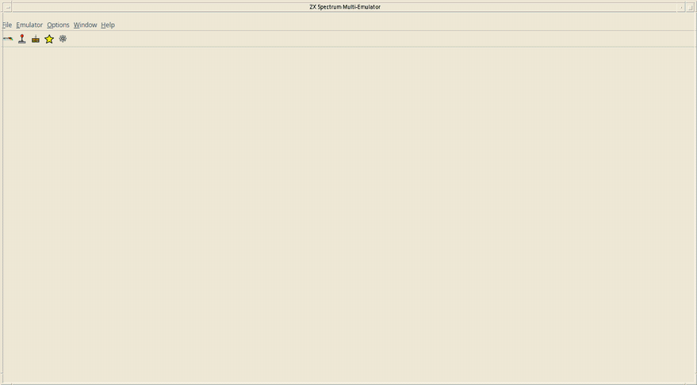
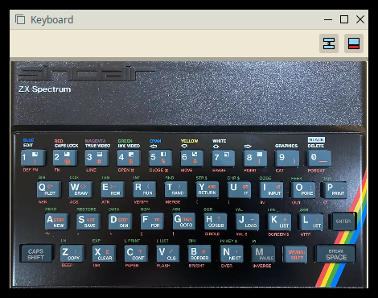

# OOZX

**The ZX Spectrum desk.** As many Spectrums as you like, forty years of hardware you plug in by hand, and
the whole catalogue a search away.

> **Clip** · the trailer: the five moments below, one after another, with the machine's own sound and no
> voice. (`trailer`, to cut from the clips)



OOZX is a ZX Spectrum emulator built as a desk. Machines, drives, printers and tape decks are windows on it,
and where a window sits is what it is plugged into. It knows which game you are running, from what is in the
file and not from its name, so the pokes, the maps and other people's recordings come with it. Underneath,
the Spectrum is made of objects down to the Z80, and the fast core is generated from that model.

## Get it

Download `oozx-<version>.jar` from the [latest release](https://github.com/fpetrola/oozx/releases/latest)
and run it with Java 21 or newer. Everything is inside.

```bash
java -jar oozx-<version>.jar
```

Windows, macOS and Linux. → [Your first five minutes](Your-first-five-minutes)

## Five things to see first

**1. Any name. The right game.**
Drop a file called `cinta3.tzx` on the desk. The machine that game needs starts loading it, and beside it a
card unfolds with everything there is about it: its screens, its maps, its pokes, other people's recordings.
It was recognised by what is inside the file. → [Your files](Your-files)

> **Clip** · `any-name`, filmed

**2. Type a name. Play.**
Open the game browser, type `dizzy`, double-click. A machine appears, `LOAD ""` types itself, and the game's
pokes are already there. → [Any game, a name away](Any-game-a-name-away)

> **Clip** · `type-a-name`, filmed

**3. Drag it on. It is plugged in.**
The Art Studio is running. Drag the Kempston Mouse's window against the machine and draw; drag the ZX
Printer's and print what you drew. No dialog, no checkbox. → [The catalogue of peripherals](The-catalogue-of-peripherals)

> **Clip** · `art-colour`, filmed

**4. Somebody else's playthrough, and then yours.**
A recording gets through the screen you never could. Press *Take Over* and the machine is yours, from that
frame. → [Recordings and Take Over](Recordings-and-Take-Over)

> **Clip** · `take-over`, filmed

**5. An hour in twelve seconds.**
Manic Miner at three hundred times its speed, with sound and picture on.
→ [How fast, and how we know](How-fast-and-how-we-know)

> **Clip** · `an-hour`, filmed

## Four nothings

| | |
|---|---|
| **Nothing to find** | The game arrives with what belongs to it. The catalogue is inside, with 5,000 games in the jar and the rest a search away; pokes for 3,612 games; 4,291 recordings catalogued; 4,922 games recognised from their contents |
| **Nothing to set up** | What you see is what there is. A window is a machine. Clipping a peripheral on is plugging it in. Settings belong to the window they are clipped to. Quit, and the desk comes back as it was |
| **Nothing to wait for** | Speed pays for everything else: 15,256 frames a second with sound and picture on, a tape that can run flat out, nine Z80s at once and still faster than a Spectrum |
| **Nothing hidden** | Everything can be looked at, changed or added. Three cores you can switch between while a game runs; seventy-five plugins in the jar and room for yours; 1,356 test vectors that both cores pass; and a page of [limits](Limits) |

Two things make those possible. **It knows which game is running**: game, file and machine. And it is
**objects down to the Z80**: every part can be replaced.

## Eight things you will never do again

| Never again | Because | The small print |
|---|---|---|
| **Look for a ROM** | a machine says which ROM it needs and who publishes it, asks, fetches it and checks it byte for byte | twenty-seven such ROMs. Some peripherals' ROMs you still supply → [Peripherals](Peripherals) |
| **Unzip an archive and guess which file is the game** | it picks the file inside, by score | |
| **Type `LOAD ""`** | it types it | untick *Fast Loading* to hear the tape and watch the stripes |
| **Rename your collection** | every file is recognised by what is inside it | only the games whose fingerprint ships: 4,922 → [Your files](Your-files) |
| **Hunt for pokes on a website** | the pokes of 3,612 games come with it, matched to the game that is loaded; and the poke finder finds the one that is missing | |
| **Open an options dialog to plug something in** | you drag the peripheral's window against the machine | the Melodik is the exception: it is fitted in the settings |
| **Lose your place when you quit** | every machine comes back running where it was | twenty-two parts come back holding what they held, each held by a test → [A file format is a table](A-file-format-is-a-table) |
| **Choose the machine for a game** | a recognised game brings the machine it was made for, and a snapshot the one it was taken on | |

## Why it all fits

The clean model is not the price of the fast emulator. It is its source.

One decision, objects down to the Z80 with no global state, explains nearly everything above: nine
processors at once is 256 colours, input swapped for a recording is *Take Over*, a machine that is a graph
of objects is six machines on one desk, and a model a program can read is a fast core nobody had to write.
→ [Why it all fits](Why-it-all-fits)

## Three ways in

| | |
|---|---|
| **[Play](Your-first-five-minutes)** | [Your first five minutes](Your-first-five-minutes) · [Any game, a name away](Any-game-a-name-away) · [Your files](Your-files) · [Pokes, and finding yours](Pokes-and-finding-yours) · [Recordings and Take Over](Recordings-and-Take-Over) · [The map draws itself](The-map-draws-itself) · [256 colours](256-colours) |
| **[The desk](The-desk)** | [The desk](The-desk) · [The machines, and yours](The-machines-and-yours) · [The catalogue of peripherals](The-catalogue-of-peripherals) · [Tape, real and virtual](Tape-real-and-virtual) · [The picture, by lead](The-picture-by-lead) · [Sound and controls](Sound-and-controls) · [It talks](It-talks) |
| **[Under the hood](Why-it-all-fits)** | [Why it all fits](Why-it-all-fits) · [The parts](The-parts) · [The fast core](The-fast-core) · [How fast](How-fast-and-how-we-know) · [How right](How-right-and-how-we-know) · [The game lab](The-game-lab) · [The translator](The-translator) · [A file format is a table](A-file-format-is-a-table) · [Build a peripheral](Build-a-peripheral) · [The rules of the code](The-rules-of-the-code) |

And to look things up: [Machines](Machines) · [Peripherals](Peripherals) · [Formats](Formats) ·
[Shortcuts](Shortcuts) · [Plugins](Plugins) · [Building from source](Building-from-source) ·
[Questions](Questions) · [Limits](Limits) · [Network and privacy](Network-and-privacy) · [Legal](Legal) ·
[What is new](What-is-new)

## The Spectrum of your country



Twenty-four machines, and among them the ones somebody's country made: the Czerweny CZ Spectrum from
Argentina, the TK90X and TK95 from Brazil, the Inves Spectrum+ from Spain, the Pentagon and the Scorpion
from Russia, the Timex machines from Portugal and the United States.
→ [The machines, and yours](The-machines-and-yours)

## Thanks

To the [Fuse](https://fuse-emulator.sourceforge.net/) authors, whose test vectors both cores here pass and
whose real core settles my arguments. To Cristian Dinu, for the
[decoding of the Z80 opcode byte](http://www.z80.info/decoding.htm). To Peter Jakubčo's
[emuStudio](https://www.emustudio.net/), for its test suite. To [ZXInfo.dk](https://zxinfo.dk/),
[ZXDB](https://github.com/zxdb/ZXDB) and the [RZX Archive](https://www.rzxarchive.co.uk/), for the
catalogues, and to the people who found the pokes.

Free software, under the GNU General Public License, version 3 or later.
Source: [github.com/fpetrola/oozx](https://github.com/fpetrola/oozx) · [Legal](Legal)
