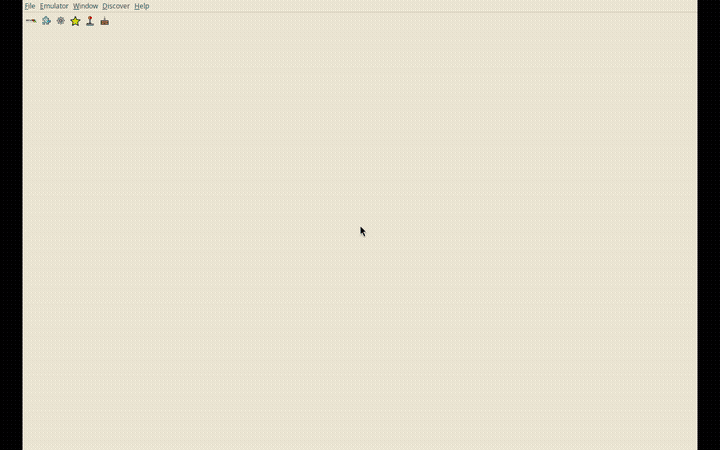

# How fast, and how we know

An hour of Manic Miner in twelve seconds, with sound and picture on. This page is how that was measured,
and what has not been measured yet.


[](https://fpetrola.github.io/oozx/clips/an-hour.mp4)
[▶ With sound](https://fpetrola.github.io/oozx/clips/an-hour.mp4)

*An hour in twelve seconds.* Manic Miner is dropped on the desk and the rocket is pressed: the caverns go by at more than twenty thousand per cent, and it comes back to 100 %.

## The numbers

A ZX Spectrum draws 50 frames a second.

| | frames a second | Spectrums' worth | an hour of it takes |
|---|---|---|---|
| Manic Miner, 48K, sound and picture on | **15,256** | about 305 | 12 seconds |
| Jet Set Willy, 128K, sound and picture on | **12,867** | about 257 | 14 seconds |
| The generated core against the object model it comes from | **4.3 times** | | |

That is not a stripped benchmark mode. It is the emulator's own loop, the one you use, with the picture
being drawn and the sound being made.

The conditions, as the diary has them: 3 September 2026, a notebook with an i5-1335U, JDK 21, pinned to two
cores, measured in blocks of one second, taking the plateau of the last four. **These figures are from the
build of that day. I have not taken them again on a released jar.**

## What the speed is for

Nobody needs to play three hundred times faster. What the speed buys is everything else:

- **Tapes with no tricks.** With *Fast Loading* on, a tape is over in a moment, and so is a game's own
  loader, because the machine really runs it. → [Tape, real and virtual](Tape-real-and-virtual)
- **Nine processors at once.** Spec256 runs nine Z80s in step and is still faster than a Spectrum.
  → [256 colours](256-colours)
- **Work in the background.** The map plays your session again on a second machine while you go on playing.
  → [The map draws itself](The-map-draws-itself)
- **Whole games as tests.** A complete recording of Jet Set Willy replays at 21,186 % of its speed, so
  replaying somebody's whole game is something a test can afford. → [How right, and how we know](How-right-and-how-we-know)

## Using it

The dial on each machine goes from 25 % to 40,000 %, with the useful range in the middle of the slider. The
bar at the foot of the machine says what it is actually reaching. At a Spectrum's own speed the sound card
sets the pace; above it the sound is dropped rather than stretched. And the processor can be changed while
the machine runs: the object model, the generated core, or Spec256's nine.

## How it got there

The processor was only the first half. Once the generated core made the processor cheap, each remaining
layer was measured, tuned in its own class, and measured again. None of it touched the model.

| Change | Measured |
|---|---|
| Memory timing applied in runs instead of one lookup at a time | Manic Miner +8 to +16 % |
| The clock without its timeout check | Manic Miner +3 to +6 %, Jet Set Willy +10 % |
| One question per write instead of five | +3 %, +7 % |
| Memory pages as plain byte arrays | **Jet Set Willy +48 %**, and it exposed a bug in a signed comparison |
| Ports and keyboard without allocating | Jet Set Willy +7 %; garbage down from 951 to 671 bytes a frame |
| The screen redone, cell by cell | its own cost fell from 17.4 % to 0.9 %, **and the frames a second did not move**, so it was thrown away |
| The sound chip synthesised from event to event | **Jet Set Willy +9 %** |
| Sound as the pacer | the rule that stayed |

From start to finish that was 13,333 and 7,939 frames a second, for Manic Miner and Jet Set Willy, becoming
15,256 and 12,867: 14 % and 62 % more, after the 4.3 times the generated core had already given.

Where the time goes now, by a profile of a Jet Set Willy replay: the **whole generated core is 8.8 %** of a
frame. Making the processor infinitely fast from here would buy about a tenth. The rest is memory, timing,
the screen and the sound.

## How these numbers were taken

This part matters more than the numbers.

- **Pinned, and taking the plateau.** On the harness of one afternoon the same code ran at 830 frames a
  second with its thread wandering between cores, and at 1,360 pinned to one: the instrument was broken, not
  the code. Pinned, and taking the mean of the last blocks, the spread inside a run went from 12 % either way
  to about 1 %.
- **Runs of A and B interleaved**, three to five rounds in both orders, best and mean reported.
- **The same work each time.** The variants of one experiment all executed exactly 29,097,384 instructions.
- **The noise is declared**, harness by harness: about 1 % pinned on the emulator's own loop, 3 % on the
  recording harness, 8 % on the small benchmark.
- **Three harnesses gave three answers to the same change**, and the diary says so rather than picking the
  flattering one.
- Changes that measured neutral were **reverted**, including ones that were more elegant.

Every number is in `doc/plan-superar-zxspin.md`, `doc/plan-nucleo-generado.md`,
`doc/plan-nucleo-generado-jvm.md` and `doc/plan-nucleo-generado-modulo.md`, with its conditions beside it.

## Against Fuse

I put Fuse's own core and this one behind the same recording and timed both. Nine recordings, played whole
from start to end, nothing pacing them, no picture and no sound on either side. Both count the same frames.

| Recording | frames | this emulator | Fuse | faster by |
|---|---|---|---|---|
| Fairlight | 102,512 | 15.40 s | 25.42 s | **65 %** |
| Jet Set Willy | 85,368 | 10.38 s | 16.72 s | **61 %** |
| Target Renegade | 56,598 | 10.95 s | 13.59 s | 24 % |
| Dark Fusion | 63,652 | 14.14 s | 17.03 s | 20 % |
| Manic Miner | 69,676 | 7.96 s | 9.57 s | 20 % |
| The Great Escape | 95,264 | 16.82 s | 19.50 s | 16 % |
| Dynamite Dan | 52,878 | 8.97 s | 9.85 s | 10 % |
| Everyone's a Wally | 184,099 | 23.78 s | 26.09 s | 10 % |
| Exolon | 112,473 | 20.40 s | 22.39 s | 10 % |

**25 % faster on average** (geometric mean), and faster on all nine. At 2 GHz that is between 9,000 %
and 17,500 % of a Spectrum's speed; scaled to the processor's 4.6 GHz peak it would be 20,700 % to 40,300 %,
which is a projection, not a measurement.

The conditions: 20 November 2026, the same i5-1335U held at **2 GHz on its four performance cores**, because
at full speed it heats up and slows down within seconds and the same run varied by 15 %; at 2 GHz its
throttle counter did not move once. Fuse 1.6.0 is its libretro core built from the upstream source, driven
by a small C program. This emulator is the generated core under GraalVM 25, two JVMs per recording, four
rounds each, the first thrown away while the JIT warms up. Both count the frames the same way; the
instructions this one ran are identical across JVMs.

What it does not say: it is the **recording player**, not the loop you play on, and neither side drew the
picture or made sound. Exolon is the best of ten JVMs: the same build lands in one of two speeds depending
on how the JIT shapes the loop, and on Exolon most JVMs settled on the slow one, about 22 s, level with Fuse.
The other games did not show the split.

### How it got there

The first run lost: Exolon took 25.9 s against Fuse's 22.2 s. Each step below was measured in alternated
JVMs, and kept only if it moved.

| Step | Exolon |
|---|---|
| Start | 25.9 s, 0.85 times Fuse |
| The player runs a frame in one loop, and only looks at the bytes of an instruction when R comes out equal to A | 24.0 s |
| A mask on the memory page index of the generated core | no change, reverted |
| A JIT option to inline the player's step | no change, not kept |
| **The processor runs the whole stretch to the end of the frame itself** | **21.0 s, 1.07 times Fuse** |

The last step is the one worth telling. A recording measures a frame in instruction fetches, which the
processor counts in its R register. The player used to ask for one instruction, read R before and after,
and ask again, 930 million times for Exolon; the hot loop was split between two classes and the JIT never
joined them. Now the player asks the processor once a frame to run *until N fetches*, and the processor
counts its own fetches, as it should, since R is its own. It is faster, it varies less, and the player lost
25 lines. This change is not in a released jar yet: the patches measured are beside the data.

Every round, the machine, the patches and the story are in `doc/performance/` in the repository.

The translator is a separate question with the same answer: a translated game is not emulated, it runs, and
how fast it runs has not been measured either. → [The translator](The-translator)

## Why Java is not the story

There are other Spectrum emulators in Java, so "in Java" is not news by itself. The mechanism is. This one
is not fast in spite of its objects: the object graph is what the generator flattens.
→ [The fast core](The-fast-core)

The diaries hold what somebody who knows the JVM would want to read: methods split sixteen opcodes at a time
so that none crosses HotSpot's limit for inlining; memory pages as byte arrays, worth 48 %; garbage brought
down from 951 to 671 bytes a frame.

## Doing it yourself

```bash
taskset -c 0-3 java -jar oozx-<version>.jar
```

Load a game, turn the dial to its maximum, and read the percentage at the foot of the machine. The harnesses
that run a fixed amount of work and report a rate are `InstructionsPerSecond` under `machine/app/src/test`
and `LoopCoreMeasurement` under `machine/machines/src/test`.

Next: [How right, and how we know](How-right-and-how-we-know).
