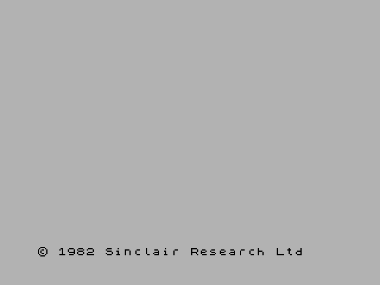
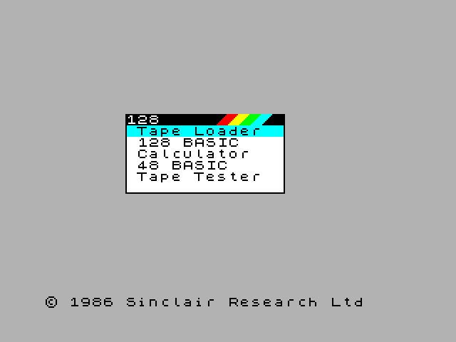
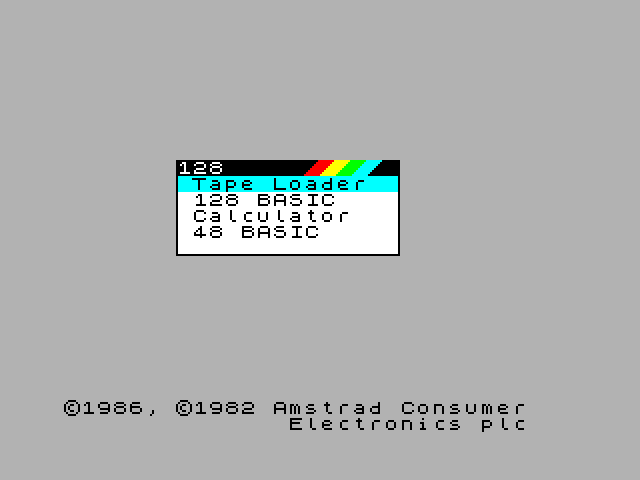
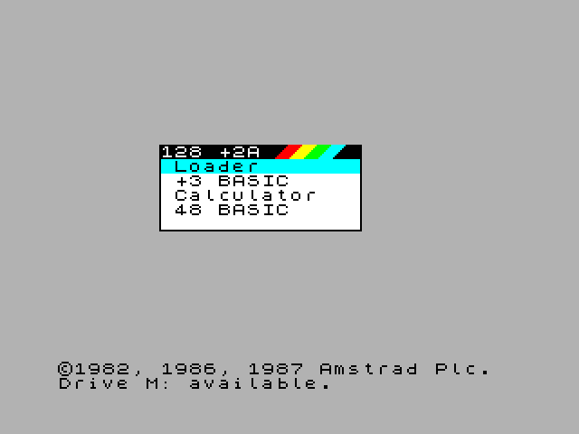
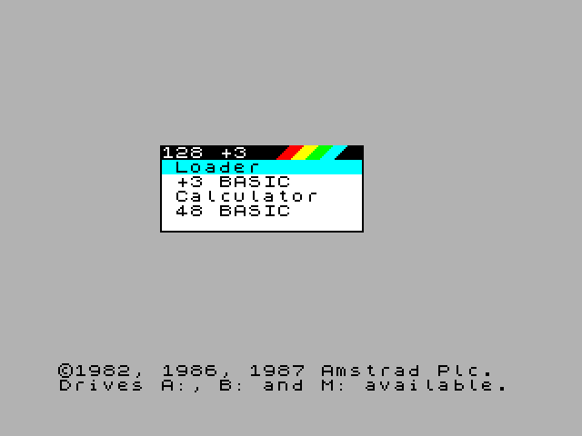
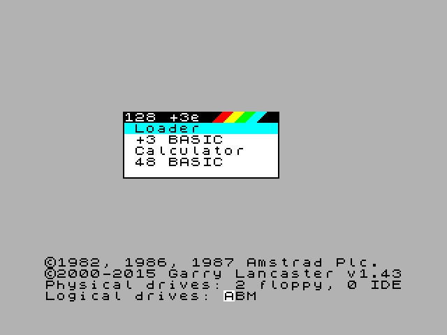
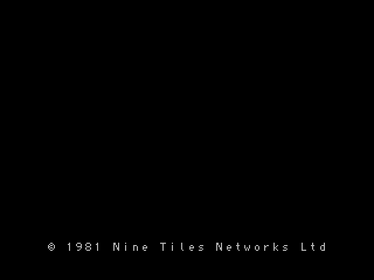
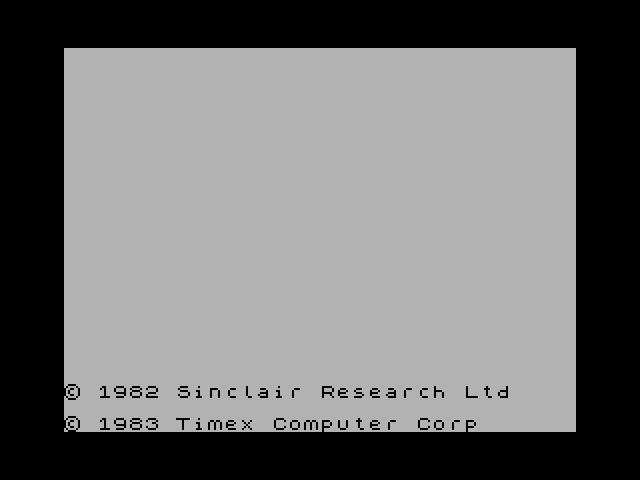

# Machines

The twenty-four models, one by one, and what a model is made of. The tour of them is
[The machines, and yours](The-machines-and-yours).

## Sinclair and Amstrad

| Model | What it is here |
|---|---|
| **Spectrum 16K** | The one Sinclair sold first: a 48K with three quarters of its memory missing, so everything above `0x7FFF` is bus and nothing else |
| **Spectrum 48K** | The machine. Contention per T-state, floating bus, issue 2 or issue 3 keyboard |
| **Spectrum 48K (NTSC)** | The same, where the mains gives sixty cycles: a shorter frame |
| **Spectrum 128K** | Paging on `0x7FFD`, the AY, the second ROM |
| **Spectrum +2** | The 128 in grey, with its own ROMs |
| **Spectrum +2A / +3** | The Amstrad pair: `0x1FFD` on top of `0x7FFD`, the special all-RAM modes, no floating bus, and on the +3 a real uPD765 with `.dsk` images in the drive |
| **Spectrum +3e** | The +3 with the IDE-oriented ROMs |

## Timex, SE, and the Eastern clones

| Model | What it is here |
|---|---|
| **Timex TC2048** | A 48K's memory and ROM socket with the SCLD doing the drawing: a second display file, 512×192 hi-res with no attributes at all, and 8×1 colour |
| **Timex TC2068** | A TC2048 with an AY on two ports of its own and a cartridge slot that covers the machine 8 K at a time |
| **Timex TS2068** | The same machine sold in America: fifty lines fewer, a slightly faster crystal, its own ROM |
| **Spectrum SE** | A 128 with a Timex display chip and cartridge slots holding RAM, so both kinds of paging are live at once and meet in one odd page at the top |
| **Chloe 140SE / 280SE** | The SE as its designer went on with it: ULAplus's sixty-four colours, and a register that asks the machine to run faster than it was built to |
| **Chrome** | A 128 with two more pages, two more ROMs and a port of its own, and one bit that puts all of it away and leaves a 128 behind |
| **Pentagon** | Contends nothing, decodes its ports fully, has no floating bus |
| **Pentagon 512K** | Five bits of page number where the port has three: the two missing ones are bits a 128 never decoded |
| **Pentagon 1024K** | A megabyte, by four more bits and a second port, which also says how to read the first, so the machine can become a later revision of itself |
| **Scorpion ZS 256** | A quarter of a megabyte through the two ports a +3 has, read differently: one bit puts page zero at the bottom, one picks a ROM of its own, one is simply a fourth page bit |

## The ones somebody's country made

| Model | What it is here |
|---|---|
| **Microdigital TK90X / TK95** | Brazil. A 48K with a ROM of its own, where the accents and the different messages live |
| **Czerweny CZ Spectrum / CZ Spectrum Plus** | Argentina. A 48K down to the ROM. Here because a machine that was sold is a machine |
| **Inves Spectrum+** | Spain. A 48K in the way a copy of a drawing is the drawing: 64 K of RAM with the ROM over the first 16, so a program reads the ROM and writes underneath it; no contention anywhere; an unanswered port reads as all ones |

## Each one on its own ROM

Every one of these booted for 320 frames and had its picture taken, with nothing loaded and nobody typing:

| | |
|---|---|
| **Spectrum 48K** | **Spectrum 128K** |
|  |  |
| **Spectrum +2** | **Spectrum +2A** |
|  |  |
| **Spectrum +3**: *Drives A:, B: and M: available* | **Spectrum +3e**: Garry Lancaster's loader, and the IDE count |
|  |  |
| **Pentagon**: a 128's menu on a machine that contends nothing | **Spectrum SE** |
|  |  |
| **Timex TC2048** | **Timex TC2068**: its own screen, behind a cartridge slot |
|  |  |

The 16K boots the 48K's screen, the Pentagon 512 and 1024 the Pentagon's, and the Chloe machines the SE's.
The Scorpion, the TK90X, the TK95, the Inves, the Chrome and the CZ Spectrum Plus run on ROMs that do not
ship: they are fetched the first time, once you say yes. The Pentagons boot on the 128's ROMs, which ship;
the Beta 128 built into them needs `trdos.rom`, which does not. → [Peripherals](Peripherals)

## What a model is

Four declarations, and no `switch` on the model anywhere else:

- **How it pages.** The 128's way through `0x7FFD`, the +3's through `0x1FFD`, or a pager of the machine's
  own. Memory is a table of 2 KB pages with a *contended* flag on each, so banking is changing that table.
- **Which chip draws it.** A ULA that decodes its ports partially, one that decodes them fully (the
  Pentagon), or the Timex's SCLD, which brings a second display file, hi-res and hi-colour.
- **How its ULA measures a frame.** The processor's clock in Hz, a line as four spans (border, picture,
  border, retrace), a frame as lines the same way, how long the interrupt is held, and the T-state of the
  first pixel *as measured*, not as computed.
- **Which ROMs.** For each machine, and for each **ROM set**: a 48K in English or Spanish, a +2 in French,
  a +3 at version 4.0 or 4.1, a TK90X in Portuguese. The same machine with other ROMs in it is not another
  machine.

Every machine is then asked the same questions by the same tests.
→ [How right, and how we know](How-right-and-how-we-know)

Only the 48K is part of the emulator. Every other model is a plugin with its ROMs, and runs on the fast core
like any other, because the fast core is made from the model's structures and not from a list of machines.

## ROMs that do not ship

For a ROM that is not mine to distribute, the plugin that brings the machine declares **where the ROM is
published and what its SHA-256 has to be**, and, for an archive that publishes a whole chip image, where
inside it the ROM starts. Twenty-seven ROMs are declared that way.

The emulator asks first, fetches from whoever publishes it, shows the download as it arrives, and keeps the
copy under `~/.oozx/roms`. A kept copy is trusted only while it still matches its hash. Which ROMs do ship,
and on whose terms, is on [Legal](Legal).

## Switching

The box at the foot of a machine's window changes the machine. Putting a machine in **is** switching it on:
it finds its own memory rather than the last one's. A snapshot says which machine it was taken on and that
is the machine it goes onto, and a recognised game brings the machine the catalogue says it was made for.
