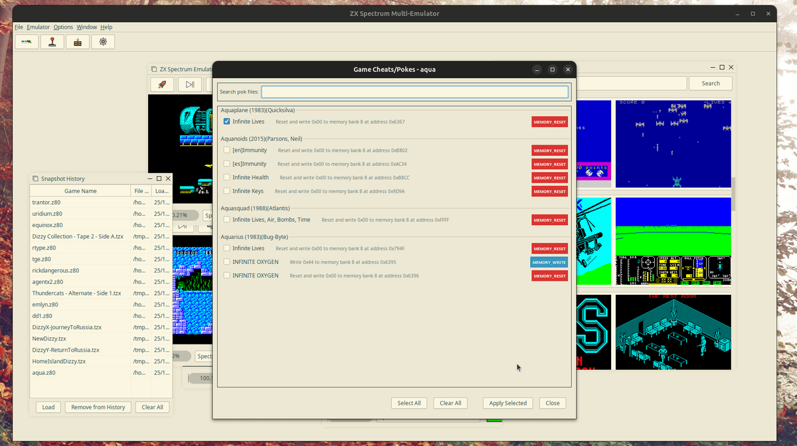

# Pokes, and finding yours

The pokes of the game you loaded are already there. And when a game has none, you can find the byte that
holds the lives by playing.

## The ones that come with it

Pokes for 3,612 games ship inside the jar, in one file, keyed by the game's catalogue number rather than
matched by its name. Because the desk knows which game a machine is running, it offers that game's pokes and
no others.

*Manic Miner's pokes, each saying what it writes and where.*

- The *Cheats/Pokes* button on a machine's bar opens them for the game that machine is running.
- The *Pokes* tile of a game's card has the same list. → [Your files](Your-files)
- Each one is a checkbox. Un-applying a poke puts the original bytes back.
- What you applied is remembered with the machine and comes back with the session.

The listings are the work of the people who found them, over decades, and were gathered at the Tipshop. Who
they are, and on what terms they are here, is on [Legal](Legal).

## Finding one that is not there

> **Clip** · *Find the lives by playing.* A life is lost and the finder is told so; three rounds later one
> address is left; *Hold*, and the lives stop going down. (`find-the-lives`, to film)

Nobody can say which address holds the lives by looking at 48K of memory. But whoever is playing knows
something the memory does not say: that a life was just lost. So the search is not of the memory, it is of
the player.

`Emulator → Equipment → Poke finder` opens the finder. Clip it onto the machine.

1. **Play until something you can name happens.** You lose a life.
2. **Say what happened.** Press *went down*. Every address whose value did not go down is thrown away. The
   other answers are *went up*, *did not change* and *changed*.
3. **Or say the number.** When the number is on the screen, three lives, type it and press *Is*: only the
   addresses holding exactly that are kept.
4. **Go round again.** The window says how many are left after how many rounds. Three or four rounds leave a
   handful out of tens of thousands.
5. **Hold it.** Choose an address and press *Hold*: it is kept at that value, the way the poke would keep it.
   If the lives stop going down, that is the one.
6. **Take it with you.** *As a poke* writes the line of a `.pok` file that does the same.

*Start over* makes every address a candidate again.

The finder watches nothing and hooks nothing. Looking at a machine's memory costs the machine no cycles
here, so a search is only looking at the same 48K again and comparing. That is why this is the whole of what
a poke finder needs to be. Poke finders are not new to emulators; this one is told for how little it took.

Next: [Recordings and Take Over](Recordings-and-Take-Over).
