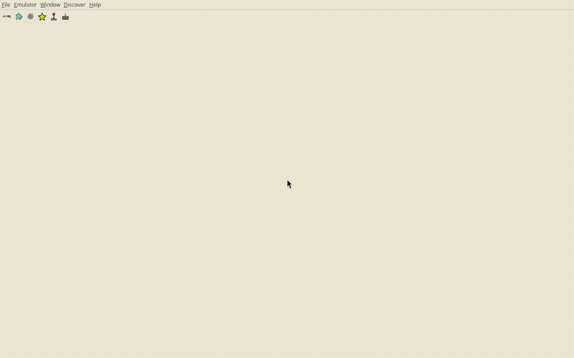
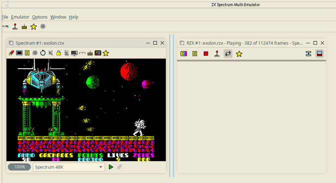

# Recordings and Take Over

Somebody else's playthrough, and then yours. Watch a recording get through the screen you never could, and
take the machine from it at any frame.

[▶ With sound](https://fpetrola.github.io/oozx/clips/take-over.mp4)

*Somebody else's playthrough, and then yours.* A recording of Exolon plays; *Take Over*; the player says the machine is yours, and the keys are.

## Watching one

A recording is somebody's whole game: not a video, but everything the player's hands told the machine, frame
by frame. Replaying it runs the real machine again and tells it the same things. There are four ways to one:

- **Drop an `.rzx` on the desk**, or a zip holding one. → [Your files](Your-files)
- **`File → Open`** takes the same files.
- **The *Recordings* tile of a game's card**: each one has a *Watch* button.
- **A right click in the game browser**: *Play Recording*.

The recording gets a machine of its own and the player's window clips onto it, with the blocks of the
recording and how far along it is. Its buttons: open, play, stop, *Take Over*, save a copy, keep it as a
favourite. A tick box loops it.

Each recording is a machine, so a handful can play side by side, each at its own speed.

## Take Over

At any frame of a replay, press *Take Over*. The recording stops telling the machine what to do, the
keyboard becomes yours, and you carry on from exactly where the recording had got to. The player says so:
"Taken over - the machine is yours, playing on from here".

## Where the recordings come from

Two catalogues, joined: the downloads ZXDB lists, and the [RZX Archive](https://www.rzxarchive.co.uk/),
catalogued here as data: 4,291 recordings with title, note, submitter and the archive's own page, each tied
to its game's catalogue number, which is what makes the two joinable. The entries the archive
marks as not to be distributed are recorded as such.

## Why a replay can be trusted

Replaying only works if the emulator does exactly what the original machine did, to the instruction: a
recording is measured in instructions fetched per frame, and every `IN` the game does is answered from the
recording, in order. Be off by one fetch anywhere and the replay falls out of step and says so.

That makes a recording a test as well as a feature: the module that reads recordings has twenty-three tests
that replay them and count the fetches of every frame. → [How right, and how we know](How-right-and-how-we-know)

## What is not there

There is no button to record your own game yet, though the format is written as well as read. There is no
rewind.

Next: [The map draws itself](The-map-draws-itself).
