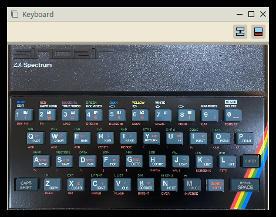
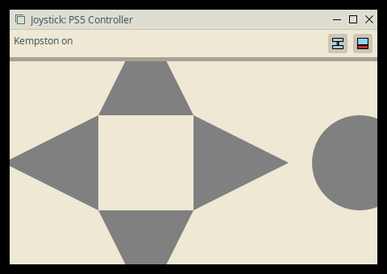
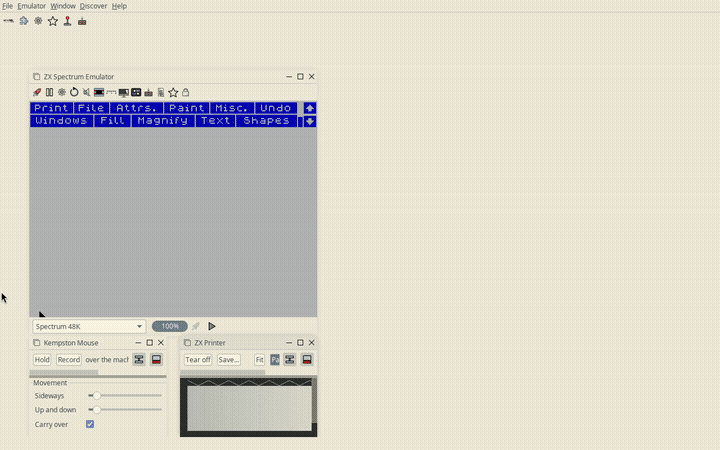

# Sound and controls

The sound card is the clock. At its own speed a machine here is not timed by a timer: it runs exactly as fast
as your sound card plays what it makes.

## Sound

### It sets the pace

A frame of the machine goes out when the sound card has room for it. The machine therefore runs as fast as
the audio is played, and the picture follows. There is no sleeping on a timer that the operating system
rounds.

Above its own speed a timer takes over, and the sound is dropped rather than stretched, so going fast does
not turn into a siren.

### What makes it

| | |
|---|---|
| **The beeper** | the one bit every Spectrum had, and the tape's ear with it |
| **The 128's sound chip** | the AY of the 128, the +2 and the +3, each write landing at the instant it happened |
| **What you plug in** | the Fuller Box, the Melodik, the SpecDrum, a Covox, the µSpeech → [The catalogue of peripherals](The-catalogue-of-peripherals) |

Everything that makes a sound mixes into the same output, and what you plug in has a level meter and a
volume on its own window. The chip's three channels come out equally in both ears: it is mono.

*Mute* on a machine's bar, or Ctrl+M, silences that machine; a right click on it is its volume.

## The keyboard

Your keyboard is the Spectrum's. Letters and digits are where they are; Shift is Caps Shift, and Ctrl and
Alt are Symbol Shift, so while a machine has the focus they belong to the Spectrum. → [Shortcuts](Shortcuts)

*CAPS SHIFT, M, SPACE and ENTER held down on the machine: each one is sunk into the photograph for as long as
the machine sees it.*

`Emulator → Equipment → Keyboard` is a photograph of a 48K with every key that is down on the machine shown
pressed into the picture. It shows what the machine reads, not what your computer sent.

It is the place to look when typing does not arrive. A key that lights here and is ignored is the game's
business. A key that never lights never got that far. And it is the whole keyboard of a Spectrum, for
whoever is sitting at a PC: it shows which keys of the machine a key of yours turns into.

If you have a Recreated ZX Spectrum keyboard, tick *Recreated Spectrum* under
`Emulator → Settings... → Input`.

## Joysticks

The Spectrum had no joystick port of its own, so every maker solved it differently: some added a port, some
wired the stick to keys of the machine's own keyboard. So a joystick here is a kind, not a switch.

| | |
|---|---|
| **Kempston** | its own port |
| **Sinclair 1 and 2**, **Cursor**, **Timex 1 and 2** | keys of the machine |
| **Fuller** | its own port, on the Fuller Box |

`Emulator → Equipment → Joystick` shows the direction and the fire as the machine reads them, and names the
pad that is doing it.

**Your own gamepad** is the Kempston of the machine in front.

## The mouse

The Kempston Mouse is a peripheral: open it from `Emulator → Equipment`, clip it onto a machine, and your
mouse over that machine's picture is the Spectrum's mouse.

[▶ With sound](https://fpetrola.github.io/oozx/clips/art.mp4)

*Drag it on. It is plugged in.* A house is drawn in the Art Studio with a thick brush, the program's pointer under the hand all the way.

**The program's pointer is put under your hand.** A Spectrum mouse only ever says how far it moved, so no
program knows where your hand is. When your pointer comes onto the picture, the peripheral walks the
program's pointer into the corner of the screen, where every program stops it, and from there to the pixel
your hand is over. From then on it counts in pixels of the Spectrum's screen, whatever size the window is.
Measured in the OCP Art Studio, the two stay within a pixel or two of each other.

- A click waits until the pointer has arrived where you clicked.
- *Hold* keeps your pointer inside the picture, for a program whose own pointer has no edges. The middle
  button lets go.
- *Sideways* and *Up and down* are how far the program's pointer goes for each pixel your hand goes over.
  1.00 is a pixel for a pixel.
- *Record* writes down what your hand did and what the program read, side by side, for when a pointer
  misbehaves.

Two things part them, and both mend themselves when your pointer leaves the picture and comes back. A
program that shuts its pointer inside a menu keeps it there while your hand goes on. And a program that stops
reading the mouse while it is busy, as the Art Studio does while it fills, never hears what you did
meanwhile.

Next: [It talks: the µSpeech](It-talks).
