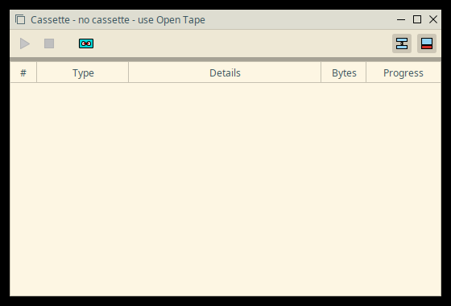
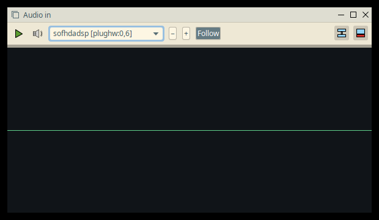

# Tape, real and virtual

A tape loads the way it did, stripes and noise and all, or in a moment if you would rather play. And a real
cassette, in a real player, loads through your sound card.

*Opening a tape: a machine appears, `LOAD ""` types itself, the border stripes, and Dizzy's loading screen
arrives a line at a time. Filmed at four times its speed.*

## Opening a tape

Drop a tape on the desk, open it from `File → Open`, or load a game from the catalogue that comes on one. A
machine appears, `LOAD ""` is typed for you, and the tape plays.

How long that takes is yours to choose, under `Emulator → Settings... → Machine`:

- **Fast Loading off**, as it ships: the tape plays at its own speed. You hear it, and you watch the stripes.
- **Fast Loading on**: the machine runs flat out while the tape plays, and drops back to the speed it had when
  the tape stops. Minutes become a moment, and it works for a loader of the game's own just as for the ROM's,
  because the machine really runs it.

*While Loading*, under `Audio`, says whether you hear the tape.

## The deck

`Emulator → Equipment → Cassette` is a cassette deck. Clip it onto a machine and it is that machine's deck:
the blocks of the tape, how far along it is, play, stop and rewind, and *Open Tape...*.

It also works with no machine at all, to look inside a tape before deciding what to do with it.

## A real cassette

> **Clip** · a cassette player beside the computer, its lead in the sound card; the trace moves on the
> oscilloscope and the game loads. With sound. (`real-cassette`, to film)

`Emulator → Equipment → Real Cassette (audio in)` opens an oscilloscope on your sound card's input. Choose the
line, zoom, follow the head, and press *Hear* to listen to what is coming in.

It is the same piece of equipment as the deck beside it, with a different cassette in it: one made of air
rather than of a file. So it clips onto a machine the same way, and while it is clipped on, what comes in
through the sound card is what that machine hears. Carry it away and the machine goes back to its own tape.

Loading from a real cassette is something other emulators do as well. What is told here is the form it takes:
a window you clip on.

## Disks, cartridges and cards

A disk goes where its drive is. The +3 has its drive built in; every other disk system is a peripheral with a
slot for each drive, where you insert, eject, flip and write-protect a disk. Microdrive cartridges go in the
Interface 1's bays, ROM cartridges in the Interface 2 or the Timex's dock, and hard disk and memory card
images in the bays of the interfaces that take them. → [The catalogue of peripherals](The-catalogue-of-peripherals)

## Keeping a machine as it is

The *Save* button on a machine's bar keeps that machine exactly as it is, to open again later. `File → Save
State...` (Ctrl+S) and `File → Load State...` (Ctrl+L) do the same from the menu. A saved machine goes back
onto the machine it was taken on, with its colours if it had sixty-four of them.

You do not have to save to keep your place: quitting does that for every machine.
→ [The desk](The-desk)

Every format that is read and written, and how the readers are checked, is on [Formats](Formats).

Next: [The picture, by lead](The-picture-by-lead).
