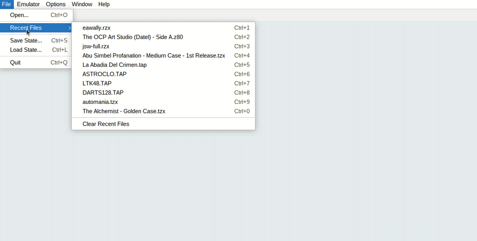
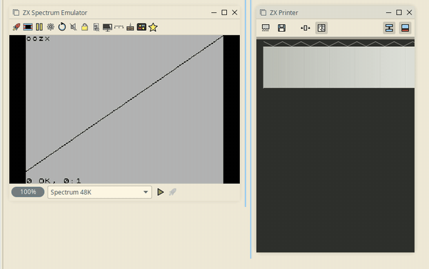
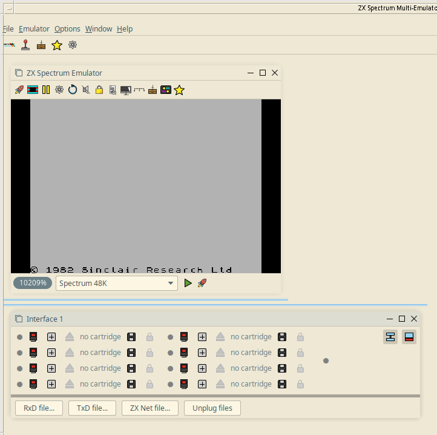

# The catalogue of peripherals

The back pages of the magazine, on your desk. More than two dozen peripherals, each a window with the front
of the thing on it. Drag one against a machine and it is plugged in; drag it off and it is not.

> **Clip** · *Drag it on. It is plugged in.* The Art Studio is running. The Kempston Mouse is clipped on and
> a house is drawn with it; the ZX Printer is clipped on and prints the house. (`art-colour`, filmed)

## Plugging one in

Everything here is under `Emulator → Equipment`, or a few letters away in `Discover → What do you want to
do?...`. Open one and you get its window. Then:

- **Drag the window against a machine's window and let go.** It is plugged in. The window says so: the
  Kempston Mouse's label goes from "not plugged into a machine" to "over the machine's picture".
- **Drag it off, or close it.** It is unplugged.
- **Carry it to another machine.** It is that machine's now.

A peripheral that brings a ROM of its own resets the machine when it goes in, as it would. Several of them
need a ROM that is not mine to ship: [Peripherals](Peripherals) says which, and how to give it to them.

A window here is not a settings page. It is the front of the thing: a slot with a motor lamp for each drive,
*Insert*, *Eject*, *Flip* and *Write-protect*; the button the real one had, *Boot*, *SNAP*, *NMI* or the red
one; a level meter and a volume knob on whatever makes a sound; paper coming out of a printer.

## Printers and pointers

| | Then | Here |
|---|---|---|
| **ZX Printer** | [Sinclair Research, 1981](https://en.wikipedia.org/wiki/ZX_Printer). It burnt its dots into aluminium-coated paper | the belt and the paper, the printout drawn as a burn rather than as a bitmap; zoom, tear off, save as a picture |
| **Parallel printer** | | continuous paper, text out |
| **Kempston Mouse** | [Kempston Micro Electronics, 1986](https://spectrumcomputing.co.uk/entry/1000221/Hardware/Kempston_Mouse) | your own mouse, over the machine's picture, moves the program's pointer; *Hold* keeps the pointer in the picture for programs that have no edges → [Sound and controls](Sound-and-controls) |
| **Joystick** | [Kempston's interface, 1983](https://spectrumcomputing.co.uk/entry/1000220/Hardware/Kempston_Joystick_Interface), and everybody else's answer to a machine with no joystick port | Kempston, Sinclair 1 and 2, Cursor, Timex 1 and 2, Fuller; and your own gamepad → [Sound and controls](Sound-and-controls) |

*`PRINT "OOZX"`, `PLOT 0,0`, `DRAW 255,175`, `COPY`, typed into the machine, and the ZX Printer bringing it
out a line at a time.*

## Things that make a sound

| | Then | Here |
|---|---|---|
| **Currah µSpeech** | [Currah Computer Components, 1983, £29.95](https://spectrumcomputing.co.uk/entry/1000081/Hardware/Currah_MicroSpeech). The box that made a Spectrum talk | it says every key you press, and anything you write for it, in English or in Spanish → [It talks](It-talks) |
| **Fuller Box** | [Fuller Micro Systems, 1983](https://spectrumcomputing.co.uk/entry/1000159/Hardware/Fuller_Box). A sound chip and a joystick port for a 48K | its own sound chip and its joystick |
| **SpecDrum** | [Cheetah Marketing, 1985, £29.95](https://spectrumcomputing.co.uk/entry/1000062/Hardware/Cheetah_SpecDrum). A drum machine of eight sampled sounds | the drum machine, with a level meter and a volume |
| **Covox** | | a converter on a port that plays whatever samples a program sends it, with its meter and its volume |
| **Melodik** | [Didaktik Skalica, 1991](https://spectrumcomputing.co.uk/entry/1001155/Hardware/Melodik). A 128's sound chip for a 48K | a 48K that plays 128K music. It has no window: it is fitted under `Emulator → Settings... → Audio` |

## Disks and tape

| | Then | Here |
|---|---|---|
| **Interface 1** | [Sinclair Research, 1983](https://spectrumcomputing.co.uk/entry/1000192/Hardware/ZX_Interface_1). Eight Microdrives, a serial port and a network | eight Microdrive bays with their motor lamps, a terminal on the desk for the serial port, and the network |
| **Beta 128** | [Technology Research, 1987](https://spectrumcomputing.co.uk/entry/1000033/Hardware/Beta_128_Disk_Interface). TR-DOS, the disk system of the Pentagon and its kin | four drives and the *Boot* button. Built into the Pentagon; plugs into a 48K or a 128K |
| **+D** | [Miles Gordon Technology](https://spectrumcomputing.co.uk/entry/1000246/Hardware/MGT_Plus_D) | the disk interface with its snapshot button, and a printer on its port |
| **DISCiPLE** | [designed by Miles Gordon Technology, sold by Rockfort Products](https://spectrumcomputing.co.uk/entry/1000117/Hardware/DISCiPLE_Interface) | the same family, its own ROM, its own button |
| **Opus Discovery** | [Opus Supplies, 1985](https://spectrumcomputing.co.uk/entry/1000297/Hardware/Opus_Discovery). A drive and an interface in one box | `.opd` and `.opu` disks |
| **Didaktik 40 / 80** | [Didaktik Skalica, 1991](https://spectrumcomputing.co.uk/entry/1000931/Hardware/Didaktik_4080) | the disk unit with its *SNAP* button, which saves whatever is running |
| **Cassette** | the recorder everybody had | a deck for each machine → [Tape, real and virtual](Tape-real-and-virtual) |

*The Interface 1, unfolded: eight Microdrive bays with their motor lamps, and the files that stand for the
serial port and the network.*

## Cards and hard disks

These came later, from people who went on building for the machine.

| | Then | Here |
|---|---|---|
| **DivIDE** | [Pavel Cimbal, 2002](https://divide.speccy.cz) | a hard disk image in its bay, its write-protect jumper and its NMI button |
| **DivMMC** | [Mario Prato, 2013](https://github.com/mprato/DivMMC) | a memory card the machine talks to a byte at a time |
| **ZXMMC** | | a card slot on two ports, and nothing else |
| **ZXCF**, **ZXATASP** | [Sami Vehmaa](https://spectrumcomputing.co.uk/entry/1000946/Hardware/ZXCF) | CompactFlash and hard disk bays, where *Save* is what commits |
| **Simple 8-bit IDE** | | a hard disk on one chip |

## Cartridges, freezers and colours

| | Then | Here |
|---|---|---|
| **Interface 2** | [Sinclair Research, 1983](https://spectrumcomputing.co.uk/entry/1000193/Hardware/ZX_Interface_2). Cartridges and two joystick sockets | a cartridge takes the place of the ROM, and the two joysticks |
| **Multiface One, 128 and 3** | [Romantic Robot, from 1986](https://spectrumcomputing.co.uk/entry/1000275/Hardware/Multiface_1). The red button that stopped any game | the red button, for each of the three machines it was made for |
| **Currah µSource** | [Currah Computer Components](https://spectrumcomputing.co.uk/entry/1000080/Hardware/Currah_MicroSource). An assembler and a Forth in 8K of ROM | its ROM, flipped in and out as the real one was: `RANDOMIZE USR 11182` brings it in. You supply the ROM |
| **ULAplus** | | sixty-four colours a program picks for itself. Plugging it in is what gives a machine those colours |
| **Spec256** | [Iñigo Ayo and David Goti's emulator, 1999](https://spectrumcomputing.co.uk/tool/13/Spec256) | a 1984 game in 256 colours → [256 colours](256-colours) |

## What is not in this catalogue

What a machine had inside when you bought it is not plugged in: the 128's sound chip, the +3's disk drive,
the Pentagon's Beta 128. That is not a peripheral, that is the computer.

What is named and not yet written is on [Limits](Limits).

The makers and years above are as each linked page gives them. Where two sources disagreed about a year, it
is left out.

## Yours

A peripheral is a small thing to write: the smallest one here is three files and under fifty lines. If the
one you had is missing, [build it](Build-a-peripheral).

Next: [Tape, real and virtual](Tape-real-and-virtual).
