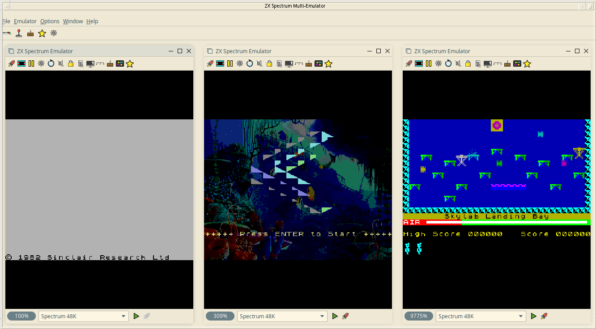
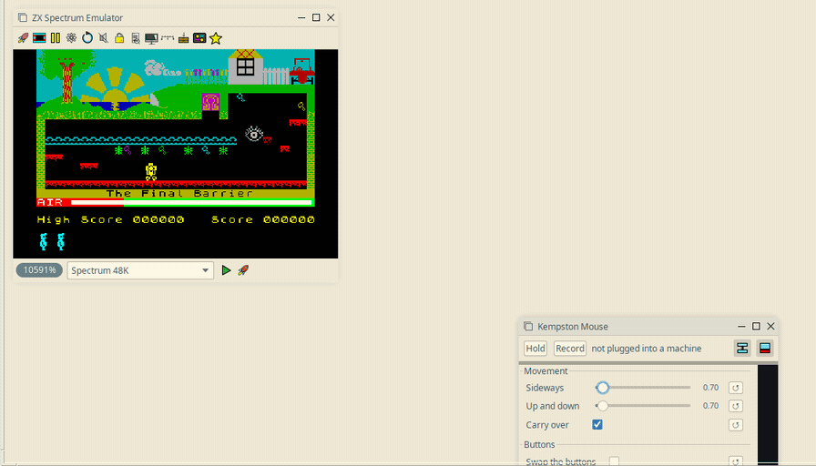
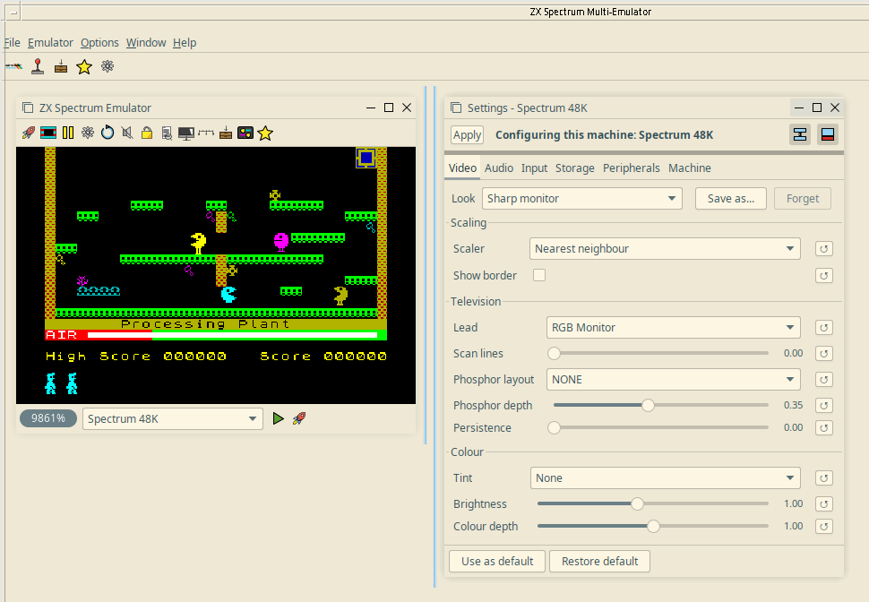

# The desk

One window holds a desk. Everything on it, a Spectrum, a cassette deck, a disk interface, the settings, is a
window on that desk, and where a window is means something.

*Three Spectrums on one desk: a bare 48K at its prompt at 100 %, Jet Set Willy in 256 colours at 309 %, and
Manic Miner at 9,775 %.*

## A window is a machine

`Emulator → New Machine` opens a Spectrum. Open six and you have six Spectrums, each with its own
model, its own speed, its own sound, its own pokes, its own picture settings, its own tape. Close a window
and that Spectrum is gone.

> **Clip** · *Six Spectrums, one desk.* Several machines side by side; one is sent flat out and another is
> paused, while the rest carry on. (`six-spectrums`, to film)

Along the top of each machine, its own controls:

| | |
|---|---|
| **The rocket** | flat out, and back. Right-click it for a speed from 25 % to 40,000 % |
| **Pause**, **Reset**, **Mute** | of this machine and no other. Right-click *Mute* for its volume |
| **Settings** | this machine's settings, opened already clipped onto it |
| **Border**, **Zoom**, **Fullscreen** | the border on or off; 1×, 2×, 3×; Escape leaves full screen |
| **Screen** | scaling, television and colour → [The picture, by lead](The-picture-by-lead) |
| **Save** | this machine exactly as it is, to open again later |
| **View Game Details**, **Keep this game in Favorites**, **Pokes** | of the game this machine is running → [Your files](Your-files) |

Along the bottom: which model it is, and the speed it is actually reaching. Choose another model there and
the machine becomes that machine.

What you type goes to the machine in front, or to the machine that the window in front is clipped to. So
typing with a cassette deck in front types into the Spectrum the deck belongs to. That includes Ctrl and Alt,
which are the Spectrum's SYMBOL SHIFT: the desk's own keys answer when no machine has the keyboard.
→ [Shortcuts](Shortcuts)

## Clip: where a window is, means something

> **Clip** · *Drag it on. It is plugged in.* The Kempston Mouse's window is dragged against a machine; its
> label goes from "not plugged into a machine" to "over the machine's picture". (`clip`, to film; the old
> one is below)

Drag a window near the edge of a machine's window and a glowing line shows where it would land. Let go, and
it is clipped: it follows that machine when the machine moves, stays in front of it, and closes with it.
Drag it off and it is a free window again. Drag it onto another machine and it belongs to that one now.

This is not decoration.

- **For a peripheral, clipping its window on is what plugs it in.** Unclipping it, or closing it, unplugs
  it. → [The catalogue of peripherals](The-catalogue-of-peripherals)
- **For a tool, the machine it is clipped to is the one it looks at.** Two machines can be under two
  debuggers at once without sharing a thing. → [The game lab](The-game-lab)
- **For the settings, what they are clipped to is what they configure.** Clipped onto a machine, the window
  says "Configuring this machine". Left free, it says "Defaults - every machine, the open ones too", and
  *Apply* writes what is set there into every machine.

Windows that share an edge go on sharing it when one of them is resized, and a clipped window folds down to
its one line of controls when you want the room.

## It comes back

`File → Quit`, and open it again: the desk is as you left it. The windows that were open are open,
where they were, and every machine is running where it was, with its pokes, its speed, its mute and its
pause as they were. What was clipped to a machine comes back clipped to it.

The machines are kept as snapshots under `~/.oozx/session/`, and every setting in `~/.oozx/config.json`.

## Asking for things by name

`Discover → What do you want to do?...` is a box you type into. "printer" finds *Plug in: ZX
Printer*; "pokes" finds *Put pokes in the game*; "full" finds *Play in full screen*. More than sixty things
answer there today, and every plugin adds its own.

> **Clip** · *Almost nothing in this emulator is in the emulator.* "printer" is typed into the box; the
> plugin that was not installed arrives, and its window opens. (`palette`, to film)

It also lists what the plugins you do **not** have would offer. Choose one of those and its plugin is
fetched, and then does what you chose. `Emulator → Plugins...` is the same thing seen from the other side:
what is installed, what is published, and what each one brought. → [Plugins](Plugins)

## The windows there are

| Window | What it is |
|---|---|
| **A machine** | a Spectrum: its picture, its bar, its model |
| **Game Browser** | the catalogue, and your own files as a gallery → [Any game, a name away](Any-game-a-name-away) |
| **A game's card** | everything there is about one game → [Your files](Your-files) |
| **Favorites** | the games and recordings you kept |
| **Pokes** | the pokes of the game a machine is running |
| **Cassette** | the blocks of a tape, with play and stop → [Tape, real and virtual](Tape-real-and-virtual) |
| **Real Cassette (audio in)** | an oscilloscope on your sound card's input |
| **RZX Player** | a recording, and *Take Over* → [Recordings and Take Over](Recordings-and-Take-Over) |
| **Keyboard**, **Joystick** | what the machine is being told → [Sound and controls](Sound-and-controls) |
| **Settings**, **Screen** | of whatever they are clipped to |
| **Every peripheral** | its front → [The catalogue of peripherals](The-catalogue-of-peripherals) |
| **Every tool** | debugger, sprites, map, poke finder and the rest → [The game lab](The-game-lab) |
| **Plugins**, **Guide** | what is installed, and these pages |

Everything a machine can have clipped to it is under `Emulator → Equipment`, on shelves: the peripherals by
what they are, the instruments in *The game lab*. The last three you opened wait above the shelves.

## A look you can live with

`Window → Look&Feel` has dozens of looks, by family: Darklaf, FlatLaf and its themes, JGoodies, Material,
Radiance and the ones that come with Java. Choosing one tries it on and asks "Keep this look?", with a
countdown that puts the old one back by itself if you say nothing. An unreadable look cannot trap you in
it. The desk starts in Solarized Light and remembers what you chose.

## Build yours

A desk to start from: a 48K with a cassette deck clipped under it and a joystick beside it; a 128K with the
game browser open next to it; a Pentagon with a disk in its drive A. Quit. It will be there tomorrow.

Next: [The machines, and yours](The-machines-and-yours).
