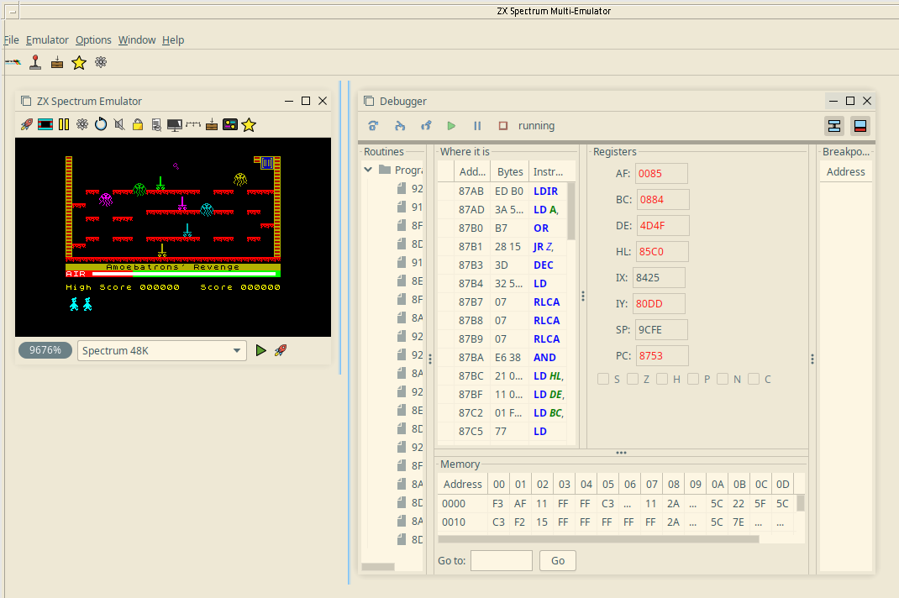
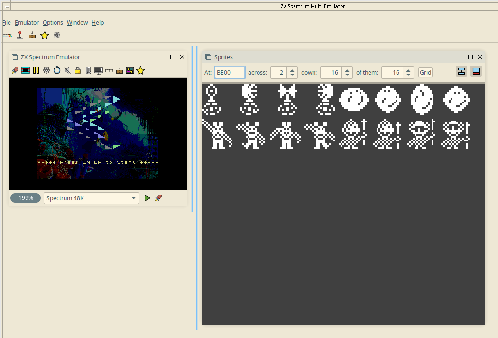

# The game lab

Instruments for looking inside a running game. Each is a window you clip onto a machine, so it looks at
*that* machine, and two machines can be under two debuggers at once without sharing a thing.

All of them are under `Emulator → Equipment`, and none of them is in the emulator: each is a plugin.

## Debugger

Where the program is, the routines found so far, the registers with their flags, the memory, breakpoints,
step, run and stop, over the machine the window is clipped to. The instructions are shown from the
instruction objects themselves, and a value is highlighted when it changes.

*Routines on the left, the instructions where it is, the registers and the memory, over Manic Miner still
running at 10,215 %.*

Two machines debugged at once do not share breakpoints or registers. That falls out of there being no
shared state anywhere in the model. → [Why it all fits](Why-it-all-fits)

## Sprites

The machine's memory read as pictures: a byte is eight pixels, a sprite is so many bytes across and so many
rows down, laid out from an address onwards. Drag to move along the memory, and zoom keeping what is under
the pointer under the pointer.

*Jet Set Willy's sprites, read straight out of the machine's memory at `BE00`: Willy's four walking frames,
the items and the guardians.*

It is for exactly what it sounds like: finding where a game keeps its graphics.

## The instruments

| | |
|---|---|
| **Map** | a game of rooms mapped as you play it → [The map draws itself](The-map-draws-itself) |
| **Poke finder** | finding the byte that holds the lives, by playing → [Pokes, and finding yours](Pokes-and-finding-yours) |
| **Heatmap** | how much code ran at each of the 64K addresses, and how much of that was just now. Two counts, because a total never goes down and only the recent one shows a routine stopping |
| **Memory map** | what is mapped where, right now, asked of the bus: a 128K's banks, the ROM, and whatever a peripheral has paged over them |
| **Frames** | what the machine did in each of the last hundred frames. A frame that ran far more instructions than the ones around it is the frame where something happened |
| **Functions** and **Calls** | the routines a run found, where each starts, how far it goes and how often it was called; and what called what, as a graph |
| **Trace** | the last instructions the machine ran, in the order it ran them, disassembled only when somebody looks |
| **Ports** | every port the machine touched, counted. It is a peripheral wired to all sixteen address lines that never drives the data lines, which is how a logic analyser is put on a bus |
| **Keyboard** | the keys the machine actually sees held → [Sound and controls](Sound-and-controls) |
| **Real Cassette (audio in)** | an oscilloscope on your sound card's input. Made for loading from a real cassette; good for looking at any signal → [Tape, real and virtual](Tape-real-and-virtual) |

> **Picture** · the heatmap, the frames and the trace clipped round a game in play. (to take)

## Why they are small

A tool here does not need a hook made for it. The processor is an object that can be wrapped, memory can be
looked at without costing the machine a cycle, and the bus can be listened to by plugging something into
it. So a poke finder is one class that compares memory with itself, and a port monitor is a peripheral that
never speaks.

## Other things that behave as instruments

- **A recording** is a test of whether the machine does the same thing every time.
  → [How right, and how we know](How-right-and-how-we-know)
- **Fuse's real core**, behind the same interface as this one, settles a disagreement about timing by
  running both over the same program.
- **A machine with no window** can be built, run and photographed by a test.
- **The settings file** is checked against the classes that declare it, so the settings cannot drift from
  what is written about them.

Next: [The translator: games as Java](The-translator).
