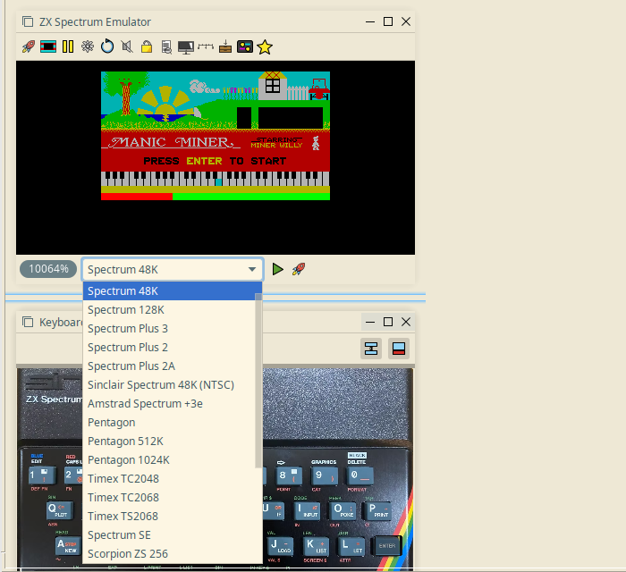
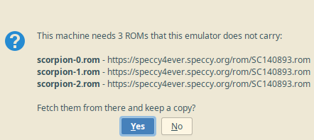
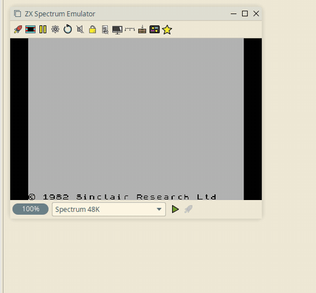

# The machines, and yours

Twenty-four Spectrums, and one of them is probably the one you had, or the one your country made. Changing a
machine into another is choosing it in the box at the bottom of its window.

## The family

| | |
|---|---|
| **Sinclair's** | the 16K, the 48K, and the 48K as it was sold where the mains gives sixty cycles |
| **The 128s** | the 128K and the grey +2, with their paging, their second ROM and their sound chip |
| **Amstrad's** | the +2A and the +3, with a real disk controller and `.dsk` images in the drive, and the +3e |
| **Timex's** | the TC2048, the TC2068 and the American TS2068, with a display chip of their own: a second screen, 512 pixels across, and colour eight times finer |
| **The SE line** | the Spectrum SE and the Chloe 140SE and 280SE that came of it, and the Chrome |
| **The Eastern ones** | the Pentagon at 128K, 512K and a megabyte, and the Scorpion ZS 256 |
| **The ones somebody's country made** | the TK90X and TK95, the CZ Spectrum and CZ Spectrum Plus, the Inves Spectrum+ |

Each boots on its own ROM and is held to its own timing: how long its frame is, which ports it answers,
where its memory slows the processor down and where it does not. What each one is, model by model, is on
[Machines](Machines).

## The Spectrum of your country

The Spectrum was cloned wherever it could not be bought, and each of these was somebody's first computer.
They are here because a machine that was sold is a machine.

| Where | Machine | What it is here |
|---|---|---|
| **Argentina** | [Czerweny CZ Spectrum](https://en.wikipedia.org/wiki/CZ_Spectrum) and CZ Spectrum Plus. Czerweny Electrónica, Paraná, 1986 | a 48K down to the ROM |
| **Brazil** | [Microdigital TK90X](https://en.wikipedia.org/wiki/TK90X), 1985, and the TK95 that followed it | a 48K with a ROM of its own, where the accents and the different messages live |
| **Spain** | [Inves Spectrum+](https://www.sinclaircollection.site/?p=453). Investrónica, 1986 | a 48K in the way a copy of a drawing is the drawing: the ROM lies over RAM a program can still write to, nothing slows the processor down, and a port nobody answers reads as all ones |
| **Russia** | [Pentagon](https://en.wikipedia.org/wiki/Pentagon_(computer)), from 1991, at 128K, 512K and 1024K; [Scorpion ZS 256](https://en.wikipedia.org/wiki/Scorpion_ZS-256), Sergey Zonov, St. Petersburg, 1991 | the Pentagon slows the processor down nowhere, decodes its ports fully and has its disk interface built in; the Scorpion reaches a quarter of a megabyte through the two ports a +3 has, read differently |
| **Portugal and the United States** | [Timex TC2048](https://spectrumcomputing.co.uk/entry/1000508/Hardware/Timex_Computer_TC2048), 1984, the TC2068, and the [TS2068](https://en.wikipedia.org/wiki/Timex_Sinclair_2068), 1983 | the TS2068 is the same machine sold in America: fifty lines fewer, a slightly faster crystal, its own ROM |

*Argentina: la CZ Spectrum se hizo en Paraná, Entre Ríos. Está en la lista de modelos, con su nombre.*

*Brasil: o TK90X e o TK95 da Microdigital estão na lista de modelos, com a sua própria ROM.*

*España: el Inves Spectrum+ de Investrónica está en la lista de modelos, con sus rarezas respetadas una por
una.*

*Россия: Пентагон и Скорпион ZS 256 есть в списке моделей.*

*Portugal: os Timex TC2048 e TC2068 estão na lista de modelos, com os seus modos de vídeo próprios.*

## When a machine needs a ROM that does not ship

Some machines' ROMs are not mine to give away. Choose one of those and it tells you which ROMs it needs and
who publishes them, and asks. Say yes and it fetches them from whoever publishes them, checks that each one
is byte for byte what it should be, and keeps the copy in your own folder, so it asks once.

*Choosing the Scorpion: it says which three ROMs it needs and where they are published, fetches them once
you say yes, and comes up on its own ROM.*

## The same machine in another language

A machine can run on other ROMs without being another machine: a 48K in Spanish, a +2 in French, a +3 at
version 4.0 or 4.1. That is the *Rom Set* of a machine, under its settings.

## A game brings its own machine

You rarely have to choose. A recognised game says which machine it was made for, and a snapshot goes back
onto the machine it was taken on. → [Your files](Your-files)

## Adding one

A machine is a handful of declarations, how it pages, which chip draws it, how long its frame is, which ROM
it runs, and it arrives as a plugin like everything else. The three Pentagons are six files and 382 lines.
→ [Why it all fits](Why-it-all-fits)

Next: [The catalogue of peripherals](The-catalogue-of-peripherals).
