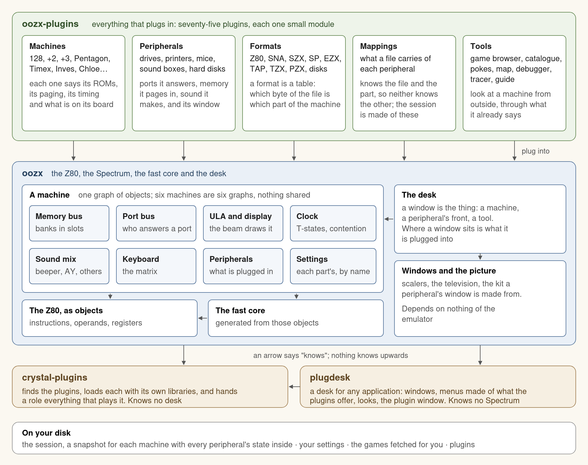

# The parts, on one page

Four repositories, and no part that knows the one above it. This is the whole of it, from the Z80 to the
window you drag.

*An arrow says "knows". Nothing knows upwards: the Spectrum has never heard of a peripheral, and the plugin
loader has never heard of a desk.*

## Reading it from the bottom

- **crystal-plugins** finds plugins, loads each one with the libraries it brought, and hands a *role*
  everything that plays it. A role is an interface: "a machine", "a peripheral", "a file format". It knows
  nothing about windows.
- **plugdesk** is a desk for any application: windows, menus made of what the plugins offer, looks, the
  window where plugins are installed. It knows nothing about the Spectrum.
- **oozx** is the Z80 as objects, the fast core generated from them, the Spectrum built on either, and the
  desk put on plugdesk. The windows and the picture are a module that depends on nothing of the emulator.
- **oozx-plugins** is everything that plugs in. Every machine that is not the 48K, every peripheral, every
  file format and every tool is a module there, and none is named by the layers under it.

## Inside a machine

A machine is one graph of objects, and two machines share nothing. What a plugin can reach is what the
graph is made of:

| Part | What plugs into it |
|---|---|
| **Memory bus** | banks placed in slots. A machine pages by moving a bank; a peripheral with a ROM puts its own over the Spectrum's |
| **Port bus** | whoever answers a port. A peripheral says the ports it decodes |
| **ULA and display** | the beam paints each cell as it passes. The Timex modes, ULAplus and Spec256 are other ways of painting |
| **Clock** | T-states, and the contention each machine declares |
| **Sound mix** | the beeper, the AY, and any source a peripheral adds |
| **Keyboard** | the matrix, which a PC keyboard, a joystick or a recording presses |
| **Settings** | each part's own, under its name. That is what a settings window, the configuration file and the session all read |

## What the separation buys

Each line is something that was built. What it cost is on [Why it all fits](Why-it-all-fits).

- **A new machine is a plugin.** The three Pentagons are six files.
- **A new peripheral is a plugin**, and its window comes from a kit. → [Build a peripheral](Build-a-peripheral)
- **A new file format is a table.** → [A file format is a table](A-file-format-is-a-table)
- **A peripheral is saved without knowing it.** Whoever knows the file maps the peripheral into it, so the
  session comes back whole. → [A file format is a table](A-file-format-is-a-table)
- **A tool watches a machine and costs it nothing**, because it reads what the machine already says.
  → [The game lab](The-game-lab)
- **The processor is swapped while a game runs**, because the machine does not know which core it has.
  → [The fast core](The-fast-core)

Next: [The fast core](The-fast-core).
