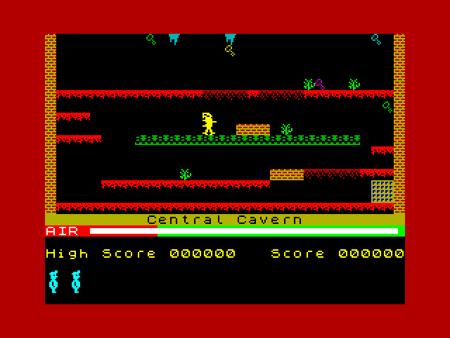
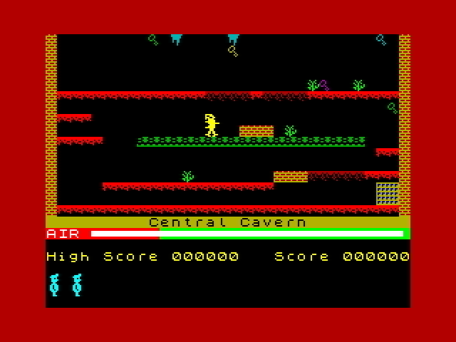
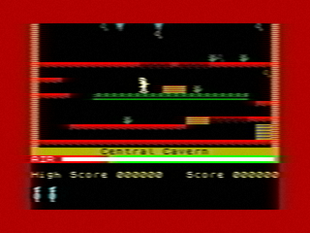
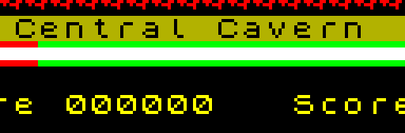
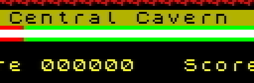
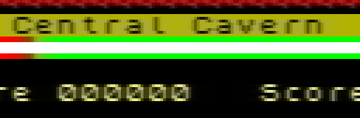
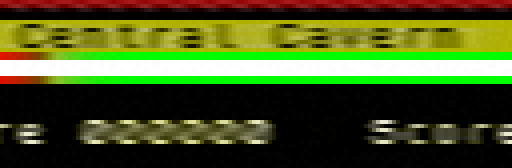
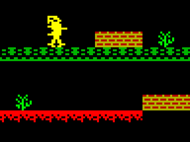
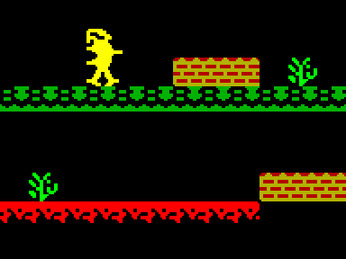

# The picture, by lead

The same picture, as it came down four different leads. What the machine drew is the Spectrum's business; how
that picture reached your eyes was the television's, and here you choose the television.

| RGB monitor | Scart |
|---|---|
|  |  |
| **Composite** | **Aerial (RF)** |
|  |  |

*The same frame of Manic Miner, the same machine, four leads.*

## Choosing

The *Screen* button on a machine's bar opens that machine's picture settings. Each machine has its own: a
loading screen on a simulated television beside a game on a sharp monitor is a reasonable thing to want.

Start from a **look**, which is a whole set of choices under one name: *Sharp monitor*, *Smooth monitor*,
*Television*, *Portable telly, 1985*, *Green screen*, *Amber screen*. Change what you like and *Save as...*
keeps it as a look of your own. *Use as default* makes new machines start with it.

`Window → TV` has the lead and the scan lines in the menu as well.

## The lead

A composite signal carries colour with a quarter of the bandwidth it carries brightness, so colour smears
sideways and brightness does not. An aerial adds the modulation on top of that. Where it shows most is on
text, enlarged here from the same four pictures:

| | |
|---|---|
| RGB |  |
| Scart |  |
| Composite |  |
| Aerial |  |

## The tube

| Knob | What it does |
|---|---|
| **Scan lines** | how dark the unlit gaps between the tube's lines are |
| **Phosphor layout** and **depth** | a colour tube has no pixels: it has stripes or dots of red, green and blue phosphor, and the picture is a beam landing across them |
| **Persistence** | how much of the frame before is still glowing. A tube fades rather than going dark, which is why a flickering game is easier to watch on one |
| **Tube curve** | how much the glass bulges. A flat panel is nothing; a small portable from the eighties is most of the way along |
| **Tint** | green phosphor, amber phosphor, black and white, sepia, or warm for the night |
| **Brightness**, **Colour depth** | how bright, and how strong the colours are: at nothing the picture is black and white, and at two it has more colour than a Spectrum ever showed |

Each knob has an arrow beside it that puts it back.

## The size

256 by 192 has to become a windowful, and there are several ways of doing that. 96 by 72 pixels of the
Central Cavern, asked of each at four times the size:

| Nearest neighbour: exact, and uneven at odd sizes | Bilinear: even, and soft |
|---|---|
|  |  |
| **Sharp bilinear**: sharp where the picture lands on whole pixels | **Scale2x**: only colours that were already there |
|  |  |
| **Edge directed**: this project's own | **xBRZ ×4**: the one that actually rounds a diagonal off |
|  |  |

**Edge directed** doubles like Scale2x, and where a corner sits inside a diagonal run it mixes the two colours
rather than choosing one, so a staircase becomes a slope. **xBRZ** is somebody else's work, Zenju's algorithm
in Stanio's Java port, used as it is and credited in [Legal](Legal).

The zoom button on a machine's bar goes 1×, 2×, 3×; the one beside it goes to full screen, and Escape comes
back. The border is a button too: games flash it, and a tape loading stripes it.

## What the machine drew

None of the above touches the machine's own drawing, and that is the real thing:

- **The beam draws it.** Each cell is painted as the beam passes over it, so a program that changes a colour
  halfway down the screen gets what it asked for. The rainbow border of a loading screen is not a special
  effect here; it is what happens.
- **The floating bus** is there on the machines that had one.
- **The Timex modes**: the second screen, 512 pixels across, and colour eight times finer.
- **ULAplus**: sixty-four colours a program chooses for itself.
- **Spec256**: 256 colours a pixel. → [256 colours](256-colours)

How the timing behind this is held to the real machine's is on
[How right, and how we know](How-right-and-how-we-know).

Next: [Sound and controls](Sound-and-controls).
