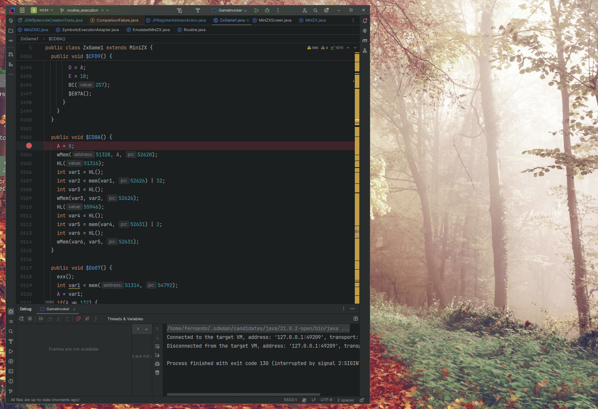
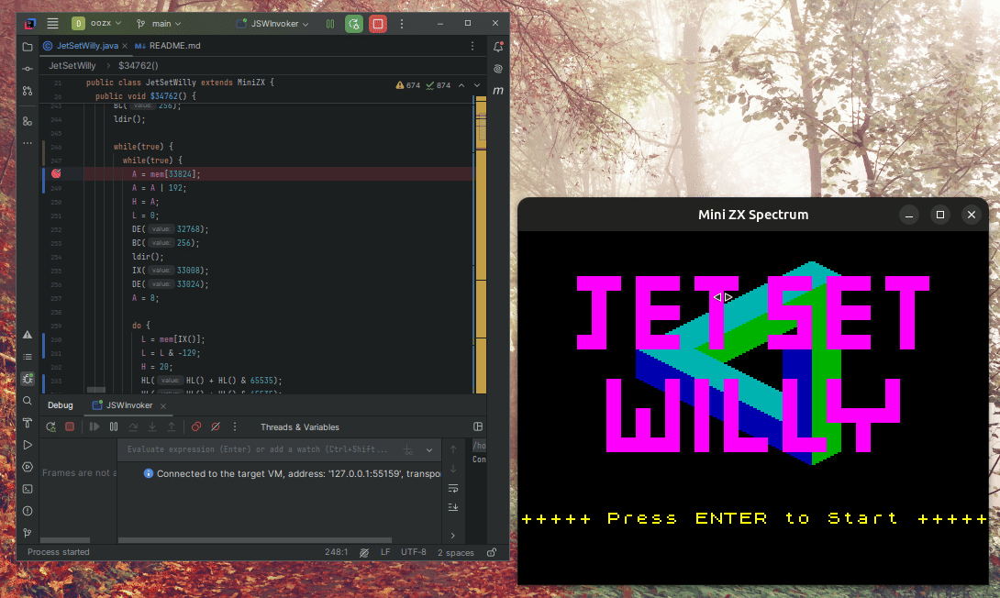

# The translator: games as Java

The same game, as a Java program. A separate tool, built on this emulator, takes a Spectrum game and writes
a Java program that does what the game does, with no emulator underneath.

It is not part of the desk. It translates some games today, twenty-nine of them, and the list grows a game
and an odd case at a time. The desk runs the same with or without it. What the desk gives it is the reason
it can exist at all: a Z80 made of objects, and an emulator to check every step against.

## It runs

| | |
|---|---|
|  | Dynamite Dan, translated to Java and **stepped in a debugger**: a breakpoint on a routine of the game, a write to its memory in the variables pane, and the game playing in a window with no emulator under it |



*These captures are from the first translations.*

> **Clip** · *The same game, as a Java program.* A Java debugger stopped inside a routine of Jet Set Willy,
> and the game running beside it. (`translator`, to film; it is not filmed on the desk)

It is Java. You can set a breakpoint in it, watch a variable, profile it, step through the frame in which
Willy dies. And you can play it, with the keyboard and with sound.

## The Z80 and the Java

The class that comes out has a method for each routine of the game, named after its address. This is a
piece of Jet Set Willy, in the loop that drives the speaker:

| The game, at 38631 | What the translator wrote |
|---|---|
| `CP B` | `pc(38631, 1, 4);` `alu("cp", A(), B());` |
| `JR NZ,38636` | `pc(38632, 1, 7);` `if (flag(64, true)) { tstates(5); } else {` |
| `LD D,24` | `pc(38634, 1, 7);` `D(24); }` |
| `OUT (C),D` | `pc(38636, 2, 12);` `out(BC(), D());` |
| `DJNZ 38631` | the `while` that goes round all of it |

And as it stands in the source:

```java
public class JetSetWilly extends MiniZX {
  public void $38601() {
    ...
    while(true) {
      pc(38631, 1, 4);
      int var6 = B();
      int var7 = A();
      alu("cp", var7, var6);
      pc(38632, 1, 7);
      if(flag(64, true)) {
        tstates(5);
      } else {
        pc(38634, 1, 7);
        D(24);
      }

      pc(38636, 2, 12);
      int var8 = BC();
      int var9 = D();
      out(var8, var9);
      ...
    }
  }
}
```

It reads like the Z80 it came from, a statement or two for each instruction. Every `pc(...)` keeps what the
original instruction was: its address, how many opcodes it fetched, and what it cost in T-states. That is
not there to be read. It is what lets the translation be checked.

It is structured Java, with loops and conditions where the game had jumps. It is not yet Java anybody would
call readable: the routines are named by their addresses.

## How a translation is checked

**A translation is held against a recording of the game being played.** The Java program and the emulator
replay the same recording side by side, and they have to agree instruction by instruction.

Head over Heels agrees with its recording for 174,364 frames. That is 58 minutes of somebody playing.

I found no earlier automatic translation of Spectrum games that is checked against a recording of the
original. What I found was done by hand:
[The Great Escape rewritten in C](https://github.com/dpt/The-Great-Escape-in-C) and
[Manic Miner in C++](https://github.com/mrcook/manic-miner) by people who read them, and
[SkoolKit](https://skoolkit.ca/docs/skoolkit/whatis.html)'s disassemblies with every routine commented.
That is a statement about what I found.

## How it grows

Every new game brings a trick the translator did not understand yet: a return address used as data, code
that rewrites itself, two stacks taking turns. Each trick, once understood, becomes a test, and the games
already translated are translated again to see that nothing was lost.

## The games so far

Counted from the translator's own catalogue and the sources it wrote, on 18 November 2026.

| Game | Lines of Java | Routines |
|---|---:|---:|
| Batman The Movie (128K) | 20,685 | 178 |
| Bomb Jack | 31,233 | 120 |
| Bruce Lee | 17,261 | 114 |
| Dizzy | 16,802 | 169 |
| Dynamite Dan | 18,778 | 145 |
| Dynamite Dan II | 20,980 | 114 |
| Emlyn Hughes International Soccer | 54,853 | 422 |
| Equinox | 24,748 | 184 |
| Everyone's a Wally | 19,267 | 119 |
| Exolon | 29,097 | 212 |
| Fairlight | 16,675 | 109 |
| Head over Heels | 44,378 | 464 |
| Jet Set Willy | 7,680 | 33 |
| Manic Miner | 8,510 | 60 |
| Monty on the Run | 23,712 | 190 |
| Movie | 28,823 | 241 |
| Quazatron | 31,297 | 137 |
| R-Type | 28,032 | 248 |
| Rainbow Islands | 51,547 | 445 |
| Renegade | 23,091 | 157 |
| Renegade (128K) | 40,713 | 310 |
| Saboteur! | 25,868 | 90 |
| Sir Fred | 58,194 | 606 |
| Skool Daze | 52,664 | 228 |
| Target: Renegade (128K) | 29,463 | 245 |
| The Great Escape | 36,095 | 205 |
| The Lords of Midnight | 30,773 | 194 |
| Turbo Esprit | 58,947 | 495 |
| Zynaps | 28,242 | 177 |
| **29 games** | **878,408** | **6,411** |

## How it is done

1. **The game is run with nobody playing.** Each instruction is an object, so it can be run without a
   machine underneath, symbolically, recording what it did: which addresses it reached, which registers
   carried what, where it branched, what it wrote over. A return address is recognised as one because the
   values remember where they came from.
2. **The trace becomes structure**: what is code, what is data, where a routine starts and ends, which
   branches are real.
3. **Java is written**: a class for the game, a method for each routine.
4. **A small runtime runs it**: a screen, a keyboard, and the handful of operations the written code calls.

A recording says where the game really went, so the translation starts from what the recording reached,
and the symbolic run covers the branches it did not take.

## How fast it is

I do not know yet, and this page will not say until it is measured.

The idea is strong: a translated game is not emulated, it runs. There is nothing to decode and no bus to
ask. But there are two reasons to measure before writing a number. The translated Java keeps, for every
instruction, its address, its fetches and its cost, which is what makes it checkable and is also work done
while it runs. And "the fastest" would not only be competing with emulators.

The measurement has what it needs. The translator already replays a recording flat out. What is left is to
run the same recording through the emulator's fast core, on the same computer, with the method on
[How fast, and how we know](How-fast-and-how-we-know).

## What it is good for

- **Debugging a game in a Java debugger**, with breakpoints and watches, on the game's own logic.
- **Reading a game's structure**: its routines, its loops, what is data and what is code.
- **A measure of the design underneath.** What a symbolic run needs from a processor is what gives tracing
  and profiling for nothing, and the fixed graph of objects that makes the analysis possible is the one the
  [fast core](The-fast-core) is generated from. The translator did not have to change the emulator to get
  either.

## What is not there

- **It does not plug into the desk yet.** It lives in a repository of its own, `oozx-translator`, which is
  not published, and the desk does not know it exists.
- **The translated sources are not published.** Each one carries the original game inside it, so publishing
  them whole would be handing out the games. This page shows pieces.

That is the detour. Next: [Build a peripheral](Build-a-peripheral).
