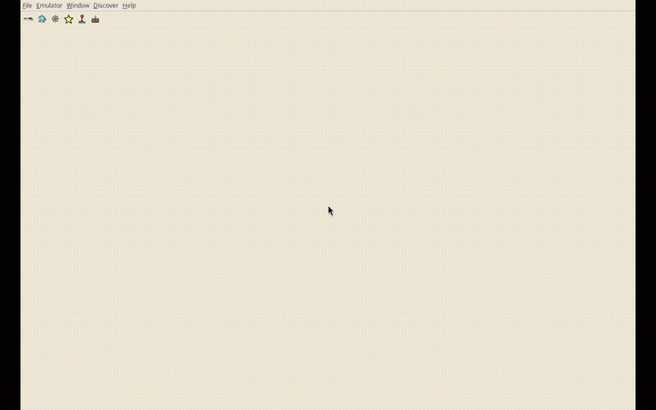

# Your first five minutes

Open the game browser, type a game, double-click. Then try the four things below.

## What you need

- **Java 21 or newer.** A runtime is enough: the fast core comes already compiled.
- **One file**, `oozx-<version>.jar`, from the
  [latest release](https://github.com/fpetrola/oozx/releases/latest). Everything is inside it: the machines
  with the ROMs that can be shipped, the peripherals, the tools, the catalogue and the pokes.

```bash
java -jar oozx-<version>.jar
```

It runs on Windows, macOS and Linux. There is no installer yet. The desk opens empty: a menu, six buttons
and room.

## Minute one: a game

[](https://fpetrola.github.io/oozx/clips/type-a-name.mp4)
[▶ With sound](https://fpetrola.github.io/oozx/clips/type-a-name.mp4)

*Type a name. Play.* The game browser opens, `dizzy` is typed, a double click, and Dizzy is loading in a machine of its own.

1. `Emulator → Game Browser...`, or its button on the desk's bar.
2. Type `dizzy` and press Enter. What comes back is the catalogue's answer, each game with its own screen.
3. Double-click one.

A machine appears with the game in it. If the game is on tape, `LOAD ""` types itself and the tape runs flat
out; the machine drops back to the speed it had when it stops. To hear the tape and watch the stripes, as it
was, untick *Fast Loading* under `Emulator → Settings... → Machine`.

What the double click did for you is on [Any game, a name away](Any-game-a-name-away).

## Then try these four things

1. **Drop a file of your own.** Drag any tape, snapshot, zip or recording from your disk onto the desk. The
   machine that game needs starts, and a card unfolds beside it with everything there is about the game,
   whatever the file was called. → [Your files](Your-files)
2. **Go faster.** The rocket on the machine's bar runs it flat out. Right-click the rocket for a
   speed of your choice, from 25 % to 40,000 %. → [How fast, and how we know](How-fast-and-how-we-know)
3. **Plug something in.** `Emulator → Equipment → Printers and pointers → Kempston Mouse` opens the mouse's window. Drag it against
   the machine's window and let go: it is plugged in. Drag it away and it is not.
   → [The catalogue of peripherals](The-catalogue-of-peripherals)
4. **Quit.** `File → Quit`. Open it again and the desk is as you left it, with every machine
   running where it was. → [The desk](The-desk)

## A machine of your own

`Emulator → New Machine` opens a Spectrum 48K at its prompt. The window is the machine, not a
picture of one: close it and that Spectrum is gone. The box at the bottom says which model it is; choose
another and the machine becomes that machine. → [The machines, and yours](The-machines-and-yours)

Some machines run on ROMs that are not mine to ship. Choose one of those and it tells you which ROMs it
needs and who publishes them, asks, fetches them once and keeps the copy.

## Finding your way

| | |
|---|---|
| `Help → Guide...` | these pages, inside the emulator |
| `Help → Keys` | every key there is, read from the menus as they stand |
| `Discover → What do you want to do?...` | find any action by typing what you want: "printer", "pokes", "full screen" |

While a machine has the focus the keyboard is the Spectrum's, Ctrl and Alt included: they are its SYMBOL
SHIFT. The desk's own keys, and when they answer, are on [Shortcuts](Shortcuts).

Next: [Any game, a name away](Any-game-a-name-away).
